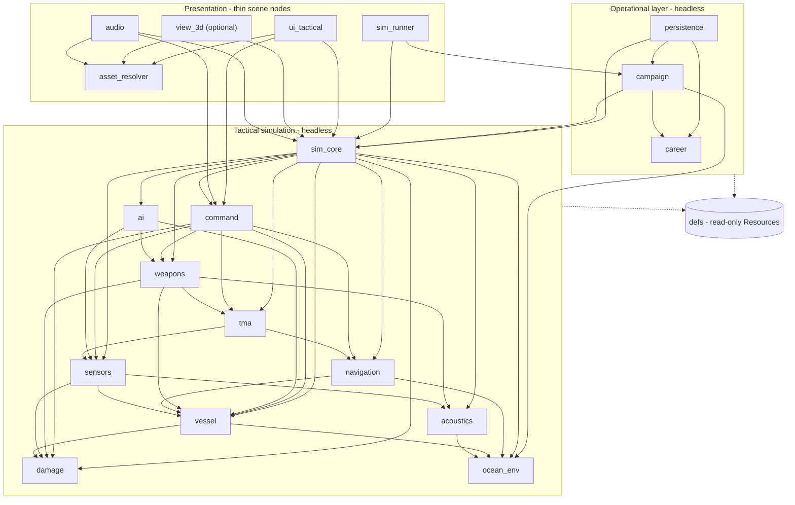

# Scope, not Godot, decides this submarine's fate

*Research Mission 001: Modern Silent Hunter spiritual successor. Research and architecture report, 22 November 2026. **Status: proposal only.** Every recommendation, module, milestone and decision in this report is a proposal for the user to judge. Nothing here is approved, and nothing here authorizes implementation, prototyping, repository creation, file changes or builds.*

**A modern-era submarine command and career simulator is feasible in Godot 4, but only as a narrow, simulation-first game.** That means one fictional conventional submarine, captain-level command with optional hands-on stations, a 2D tactical core that leaves the 3D question open, and a campaign grown in stages from single encounters to generated patrols. The engine does not set the limit. Godot 4.7, the current stable branch, documents the headless scripting, custom 2D instrument drawing, embedded 3D views, runtime asset loading and test tooling this design needs ([Godot release policy](https://docs.godotengine.org/en/stable/about/release_policy.html); [GUT README](https://raw.githubusercontent.com/bitwes/Gut/main/README.md)). The limits are opponent AI, campaign scope and tuning, the same three things that have stalled better-resourced peers. Modern Naval Warfare, the closest modern comparator, entered Early Access in May 2026 with every Virginia-class station modelled but **no enemy combat AI**, and it sits at **56% positive** ([Steam: Modern Naval Warfare](https://store.steampowered.com/app/1816640/Modern_Naval_Warfare/)). Sea Power's dynamic campaign has slipped from a Q2 2025 target to **2027** ([Simulation Daily, Oct 2026](https://simulationdaily.com/news/sea-power-royal-navy-argentina/)). That leaves a real opening. No current title combines a modern submarine with Silent Hunter III's free patrol in a living war and a persistent career with a crew the player cares about. The recommended first step is an experiment, not a game: a 2D "acoustic duel" in which one submarine must find, attack and escape one escort that fights back. It would prove both the tension loop and the simulation architecture before any money goes into art, campaign or station depth. Seventeen decisions need the user's approval before this begins, starting with the Godot version, the language and the test framework.

## How to read this report

**Labels.** Every substantive claim carries one of five labels, used the same way throughout:

- [Fact] is confirmed by the cited public source: official pages, store pages, engine documentation, encyclopedia entries or court reporting.
- [Reported] is a reviewer, community, developer-roadmap or search-excerpt-only claim. It is credible but lower in confidence or tied to a game version.
- [Estimate] is an approximate figure or the researchers' own arithmetic.
- [Inference] is an analytic judgment drawn from cited evidence.
- [Recommendation] is a proposal that the user may approve or reject. It is never a decision.

Store figures are snapshots from November 2026.

**Sensitive data.** Military performance figures appear only as public, deliberately imprecise "floor" values such as "25+ knots". The report never presents classified characteristics as known. Every number proposed for the game itself is a fictional tuning value.

**Precedents, not copies.** Other games are cited only as design precedents, and nothing proprietary is to be copied from them: no assets, code, data files or interface layouts.

**Evidence quality.** Several primary sources (navy.mil, GameSpot, ModDB and some naval reference sites) blocked direct fetching. Claims that rest only on search excerpts of those pages are labelled [Reported].

**Mode.** The report follows the CLAUDE.md "Game design" mode. It records no decision in `docs/PROJECT_BRIEF.md`, which still lists the title, Godot version, platforms and test framework as Undecided.

| Mission research area | Where it is answered |
|---|---|
| 1. Reference games | §2 Competitor comparison |
| 2. Player experience | §3 |
| 3. Simulation | §4 |
| 4. Campaign | §5 |
| 5. Modern submarines | §6 |
| 6. Graphics and interface | §7 |
| 7. Godot architecture | §8 System dependency map, §9 Architectural proposal |
| 8. Feasibility | §1 Feasibility report, §10 Risk assessment, §11 Milestones |
| Decisions for the user | §12 Key design decisions requiring user approval |

## 1. Feasibility report: buildable if the first boat, screen and campaign stay small

### Executive summary

**Overall verdict: conditionally feasible.** [Inference] The Silent Hunter loop carries into the modern era almost one-to-one. It runs like this: a long transit under time compression, a contact that drops time back to 1x, an approach and attack under acoustic uncertainty, an escape from a hunter that searches credibly, then port, refit and promotion. Every model the loop needs exists in unclassified textbook form at a cost that typed GDScript should be able to afford, though that still has to be measured (§4, §10). What a small team cannot build on any engine is everything the genre has ever attempted at once: every station on every platform (Dangerous Waters), a continuously simulated theatre war (Falcon 4.0) and a walkable interior (Silent Hunter 5). Each of these alone took a dedicated studio years.

**The engine is a supported but unprecedented choice.** [Fact] Godot 4.7 shipped on **18 June 2026**, and its 4.7.2 maintenance release followed in August. The release policy keeps a branch supported until the next one ships and receives a patch ([Godot 4.7 release](https://godotengine.org/releases/4.7/); [Godot 4.7.2](https://godotengine.org/article/maintenance-release-godot-4-7-2/); [Godot release policy](https://docs.godotengine.org/en/stable/about/release_policy.html)). [Fact] GUT 9.7.1 targets Godot 4.7.x and returns exit code 1 on failure, so a headless test runner can be pinned to the same minor version ([GUT README](https://raw.githubusercontent.com/bitwes/Gut/main/README.md); [GUT command line](https://gut.readthedocs.io/en/latest/Command-Line.html)). [Fact] Runtime WAV loading arrived in Godot 4.4, which means the project's `custom/` override contract can accept PNG, OGG Vorbis and WAV without hand-written parsers ([Godot 4.4 release](https://godotengine.org/releases/4.4/)). [Fact] A SubViewport renders a 3D scene into 2D UI, which is all a periscope view needs ([Godot docs: Using Viewports](https://docs.godotengine.org/en/stable/tutorials/rendering/viewports.html)).

Two findings temper this. [Fact] `Engine.time_scale` stretches each tick's delta instead of adding ticks, loses precision above 1.0 and does not change audio speed. Silent Hunter-style compression therefore has to be built into the simulation rather than taken from the engine ([Engine class reference](https://docs.godotengine.org/en/stable/classes/class_engine.html)). [Fact] The research found **no commercial naval or submarine simulator built in Godot**. The nearest precedent is PVKK, an instrument-heavy cannon-operation sim from the Dome Keeper studio ([Godot showcase: PVKK](https://godotengine.org/showcase/planetenverteidigungskanonenkommandant/)).

**The hard parts are AI, the campaign and tuning, not rendering.**

- **Falcon 4.0's campaign.** [Reported] Its lead engineer recalls about **five years of development and about 50 people over the project's life**. The campaign ran on roughly a 5% CPU budget. He would now "do a mix of scripted/generated missions" ([Klemmick interview](https://sites.google.com/site/falcon4history/interview)).
- **Eagle Dynamics.** [Reported] Its own dynamic campaign had been in development for "approximately five years" with no release date as of January 2026 ([FSElite, Jan 2026](https://fselite.net/content/eagle-dynamics-reveals-2026-roadmap-with-focus-on-dynamic-campaign-and-vulkan-api/)).
- **Sea Power.** [Fact] Work began in 2018, and "feature creep and an overly-optimistic plan" led to an Early Access release instead of a full one ([Wikipedia: Sea Power](https://en.wikipedia.org/wiki/Sea_Power:_Naval_Combat_in_the_Missile_Age)).
- **Cold Waters, the counterexample.** [Fact] A team of **two full-time developers plus a consulting artist** shipped it to **87% positive across 3,523 Steam reviews** ([RPS interview via CombatACE](https://combatace.com/forums/topic/90480-rock-paper-shotgun-interview-with-cold-waters/); [Steam: Cold Waters](https://store.steampowered.com/app/541210/Cold_Waters/)). They did it by abstracting the stations, the crew and the strategic layer.

**Recommended approach.** [Recommendation] The proposal has eight parts:

- **Command model.** Captain-first command, where every station can optionally be taken over by hand and each has a three-state automation switch.
- **Starting boat.** A fictional composite diesel-electric boat with air-independent propulsion (SSK/AIP) as the first platform.
- **Simulation fidelity.** Mid-fidelity, parametric acoustics, with a bearings-only target estimator that shows its uncertainty honestly.
- **Simulation core.** A headless `RefCounted` core running fixed steps at several rates, with its own time compression.
- **Presentation.** 2D first, with a presentation spike before any art is commissioned.
- **Campaign.** Staged growth.
- **Tooling.** Typed GDScript and GUT.
- **First milestone.** A 2D acoustic duel.

**The truth/belief firewall.** The most important architectural rule is a firewall between simulation truth (where everything really is) and the player's picture (what the boat believes). [Inference] One rule does four jobs:

- It produces Dangerous Waters' "Hide Truth" tension.
- It keeps opponent AI honest.
- It makes the core testable without scenes.
- It lets the presentation change without touching the simulation.

### Verdict by dimension

| Dimension | Verdict | Confidence | Basis |
|---|---|---|---|
| Engine capability (Godot 4.7) | Feasible | High | Headless scripting, custom 2D drawing, SubViewport, runtime asset loading and GUT or GdUnit4 are all documented for 4.7. No naval precedent exists. |
| Simulation core and time compression | Feasible with a custom design | Medium-high | Must bypass `Engine.time_scale`. A naive design needs about 6.7 million sensor-pair checks per frame at 1000x [Estimate]. |
| Acoustics, sonar and target motion analysis (TMA) | Feasible at parametric fidelity | High for physics, medium for tuning | The sonar equation is decibel arithmetic. Layer penalties and similar values are not public and must be invented and playtested. |
| Opponent AI and crew automation | Feasible; the highest effort | Medium | Modern Naval Warfare shipped without opponent AI. Credible escorts are what carry the tension. |
| Dynamic campaign and career | Feasible only if staged and abstract | Medium | Living-world campaigns took about five years at Falcon and Eagle Dynamics. Abstract layers are proven by Cold Waters. |
| 3D presentation | Feasible for a local bubble; a walkable interior is high risk | Medium-low | No Godot FFT-ocean benchmarks exist, the leading ocean addon is experimental, and SH5's interior was criticised as slow. |
| Audio | Feasible with samples; live synthesis needs profiling | Medium | The docs recommend C# or GDExtension for `AudioStreamGenerator`. |
| Schedule | Unknown, probably long | Low | Team size is undecided. Sea Power and Modern Naval Warfare each took about 5–6 years to reach Early Access [Estimate]. |

### What would change the verdict

[Inference] The verdict assumes a small team, but `docs/PROJECT_BRIEF.md` records no team size or time budget. A one- or two-person team should expect the milestones in §11 to take years, not months. The only fast small-team precedent, Cold Waters, came from a studio that had already shipped *Atlantic Fleet*, and its development time is not public. Two kinds of request would turn the verdict to "not feasible in reasonable time" for a small team:

- station-first, full-fidelity play as the first deliverable;
- a self-planning theatre AI as the first deliverable.

On the evidence side:

- **Performance.** No benchmark of GDScript on these specific workloads was found, so the first milestone must measure it. If GDScript falls short, the language decision reopens (§12, D2).
- **Manuals.** The Dangerous Waters and Cold Waters manuals were not consulted. Their mechanics are described from reviews and community guides.
- **Sea Power's sonar model.** It is documented only by a community guide written before a rework.

## 2. Competitor comparison: nobody ships the modern patrol-and-career loop

The seven reference titles sit on a line from abstracted captaincy to full station fidelity. None of them pairs a modern boat with Silent Hunter's career.

| Title (developer, year) | Command model | Campaign and career | Core strengths | Main compromises | Reception ([Fact] unless noted) |
|---|---|---|---|---|---|
| Silent Hunter III (Ubisoft Bucharest, 2005) | Captain over a visible 3D crew. Any station reachable instantly. Realism toggles for manual targeting and map contacts. | Dynamic patrol-grid career, 1939–43. Renown as currency. Persistent crew rank, experience and morale. | Living-war feel, career pull, tension from sound-only awareness and escalating escorts | No AI wolfpacks or resupply at launch. Repetitive HQ messages. Assists that remove tension. [Reported] | Metacritic 90 ([Wikipedia](https://en.wikipedia.org/wiki/Silent_Hunter_III)) |
| Silent Hunter 4 (Ubisoft Bucharest, 2007) | As SH III, plus manual radar, sonar and torpedo allocation | Dynamic campaign with special missions (insertion, reconnaissance). Contact reports age. [Reported] | Mission variety, intelligence decay | Stability problems at launch. "Not a fully dynamic campaign." [Reported] | Metacritic 79 ([Wikipedia](https://en.wikipedia.org/wiki/Silent_Hunter_4:_Wolves_of_the_Pacific)) |
| Silent Hunter 5 (Ubisoft Bucharest, 2010) | Walkable first-person interior; orders given in person | One Type VII, 1939–43. No promotion to better boats. [Reported] | Atmosphere | Slow travel between stations, buggy morale, no control remapping [Reported]. Always-online DRM. | Metacritic 62 ([Wikipedia](https://en.wikipedia.org/wiki/Silent_Hunter_5:_Battle_of_the_Atlantic)) |
| Dangerous Waters (Sonalysts, 2005) | Operate every station on seven platforms, with a competent "autocrew" per station | Authored, branching campaign of 11 missions. No career. | Procedural depth, manual TMA, "Hide Truth" contacts | Manual of about 570 pages, steep learning curve, cluttered map | Metacritic 82; Steam 79% of 353 ([Wikipedia](https://en.wikipedia.org/wiki/Dangerous_Waters_(video_game)); [Steam](https://store.steampowered.com/app/1600/Dangerous_Waters/)) |
| Cold Waters (Killerfish, 2017) | Captain only. No stations; the AI crew does TMA. 3D view plus 2D tactical map. | Strategic map with time-sensitive randomised missions and a moving war. No crew or career. | Readable stealth tension, valid layer and convergence-zone tactics, text-file modding | Crew not modelled. No voices or message history at launch. Thin campaign layer. [Reported] | Steam 87% of 3,523 ([Steam](https://store.steampowered.com/app/541210/Cold_Waters/)) |
| Sea Power (Triassic Games / MicroProse, Early Access 2024) | Task-force and unit command; 3D view plus 2D map | Linear and branching campaigns. Dynamic campaign reported as delayed to 2027. | Sound-speed-profile acoustics, 200+ units, an editor and 4,000+ Workshop items | The submarine is one unit, not a captaincy. Players cannot see the detection maths. [Reported] | Steam 91% of 4,292 ([Steam](https://store.steampowered.com/app/1286220/Sea_Power__Naval_Combat_in_the_Missile_Age/)) |
| Modern Naval Warfare (Wave Ops / Matrix Games, Early Access May 2026) | Every Virginia-class station modelled, with a clickable control room. Assistance and "Show Truth" options added in October 2026. | 18 authored South China Sea missions. No career. | The deepest modern instrument set (narrowband, DEMON, TMA rulers, flooding by permeability) | Launched without enemy combat AI. Performance problems. $59.99 Early Access price. | Steam "Mixed", 56% of 248 ([Steam](https://store.steampowered.com/app/1816640/Modern_Naval_Warfare/)) |

The table below rates each title against Silent Hunter's four pillars. All ratings are [Inference], drawn from the evidence in this section.

| Title | Tension | Immersion | Autonomy (free patrol) | Dynamic career |
|---|---|---|---|---|
| Silent Hunter III | Strong | Strong | Strong | Strong |
| Silent Hunter 4 | Strong | Strong | Strong | Strong |
| Silent Hunter 5 | Partial (undercut by bugs) | Strong atmosphere, undercut by friction | Partial (chapters) | Weak (one boat, no promotion) |
| Dangerous Waters | Strong (cognitive) | Strong (procedural) | Weak (authored missions) | Absent |
| Cold Waters | Strong | Weak | Partial (mission drops on a strategic map) | Absent |
| Sea Power | Partial (task-force scale) | Partial | Partial (scenarios) | Absent (dynamic campaign not shipped) |
| Modern Naval Warfare | Weak at launch (no opponent) | Strong (instruments) | Weak | Absent |

### Silent Hunter set the bar with four interlocking systems

[Fact] Silent Hunter III's career used no scripted missions. It "simply assigns the player a certain patrol grid," and the engine generates convoys, escorts and task forces. Crew rank, experience, morale and decorations persist between patrols ([Wikipedia: Silent Hunter III](https://en.wikipedia.org/wiki/Silent_Hunter_III)).

[Reported] Renown was the currency. The player earned it by sinking ships and bringing boat and crew home, and spent it on crew, equipment and newer boats. Negative renown could end a career ([SH3 manual, Scribd copy](https://www.scribd.com/doc/44870023/Sh3-Manual-En); [Subsim SH III review](https://www.subsim.com/ssr/sh3_rc1/sh3_review1.htm)).

[Reported] The war calendar doubled as the difficulty curve. Escorts grew more persistent after 1942, and aircraft and radar increasingly punished surface running. An enemy contact dropped time compression to 1x, which was capped at 32x near port or enemies ([Subsim SH III review](https://www.subsim.com/ssr/sh3_rc1/sh3_review1.htm)).

The tension came from scarce information, and the assists could destroy it. [Reported] VideoGamer said external cameras turned "a life and death battle of wits into a turkey shoot" and that the stealth meter served "to rob the player of any sense of tension during an attack" ([VideoGamer](https://www.videogamer.com/reviews/silent-hunter-iii-review)).

[Inference] The career's pull came from four persistent systems working together:

- a date-driven escalation curve;
- a currency earned only by surviving and sinking;
- named crew who grow;
- boat progression gated by date and renown.

The decline from there was steep. [Fact] Metacritic scores fell from **90 to 79 to 62** ([Wikipedia: SH III](https://en.wikipedia.org/wiki/Silent_Hunter_III); [Wikipedia: SH4](https://en.wikipedia.org/wiki/Silent_Hunter_4:_Wolves_of_the_Pacific); [Wikipedia: SH5](https://en.wikipedia.org/wiki/Silent_Hunter_5:_Battle_of_the_Atlantic)). Silent Hunter 5's problems stacked up:

- **Travel between stations.** [Reported] Bit-tech wrote that "actually having to move between stations was never going to be fun" ([bit-tech SH5 review, p.1](https://bit-tech.net/reviews/gaming/pc/silent-hunter-5-review/1/)).
- **Crew and controls.** [Reported] Morale was buggy, there was no control remapping, and the reviewer said "you can no longer hope to get promoted to a better class" ([bit-tech SH5 review, p.1](https://bit-tech.net/reviews/gaming/pc/silent-hunter-5-review/1/)).
- **DRM.** [Fact] Always-online DRM, after a denial-of-service attack, left the game unplayable for several days ([Wikipedia: SH5](https://en.wikipedia.org/wiki/Silent_Hunter_5:_Battle_of_the_Atlantic)).

[Inference] Silent Hunter 5 removed one of the four pillars, boat progression, and the whole career weakened.

**Community mods mark the gaps players filled with their own time.** [Reported] GWX made Silent Hunter III "much harder" and added harbour traffic and a full sound mod ([Steam SH III discussion](https://steamcommunity.com/app/15210/discussions/0/4523281307941712796); [CombatAce: GWX OneAlex](https://combatace.com/forums/topic/96229-grey-wolves-expansion-onealex-edition)). TMO plays Silent Hunter 4 without map contacts, and "practically everyone" uses the RSRDC historical-traffic mod for Silent Hunter 4 ([Steam SH4 discussion](https://steamcommunity.com/app/15200/discussions/0/1368380934236402420)). [Inference] Those gaps are credible traffic, difficulty without omniscience, atmosphere and stability.

### Modern titles split the formula and dropped the career

**Dangerous Waters is "be every operator."** [Fact] It offers seven playable units (two US SSN classes, the Akula and Kilo, an MH-60, a P-3 and a frigate). Radar and sonar can be run by hand or handed to AI crew ([Wikipedia: Dangerous Waters](https://en.wikipedia.org/wiki/Dangerous_Waters_(video_game))). [Reported] SUBSIM describes a "Hide Truth" model in which displayed contacts reflect only what sensors and best guesses have established. It also reports that bearing lines pile up until "the NavMap looks like a game of Chinese Pick-up Sticks" ([SUBSIM DW review, p.2](https://www.subsim.com/ssr/dangerous_waters/dangwater_review_page2.htm)). The campaign is an authored storyline with no career ([SUBSIM DW review, p.1](https://www.subsim.com/ssr/dangerous_waters/dangwater_review_page1.htm)).

**Cold Waters is "be the captain."** [Fact] Its developer kept Red Storm Rising's focus on "your decisions as a commander, rather than the technical operation of various stations." Its sonar model covers thermal layers, convergence zones and bottom bounce, and "crew abilities, health, and morale" do not affect gameplay ([RPS interview via CombatACE](https://combatace.com/forums/topic/90480-rock-paper-shotgun-interview-with-cold-waters/)). [Reported] Critics found the campaign layer "perfectly fine" but static, with no after-action replay ([Scientific Gamer](https://scientificgamer.com/thoughts-cold-waters/)). By late 2019 players were complaining of "a year and a half since any update" ([Steam thread](https://steamcommunity.com/app/541210/discussions/0/1744513943986905764)).

**Sea Power is fleet command.** [Fact] Players "command fleets or directly control units" across 200+ units ([Wikipedia: Sea Power](https://en.wikipedia.org/wiki/Sea_Power:_Naval_Combat_in_the_Missile_Age)). [Reported] A community guide complains that "we cant see the exact equation the game is using" for detection ([Steam guide](https://steamcommunity.com/sharedfiles/filedetails/?id=3654466303)).

**Modern Naval Warfare is instrument fidelity.** [Fact] Its EA build shipped "without full enemy combat AI", leaving enemies with only countermeasures and evasion ([Steam](https://store.steampowered.com/app/1816640/Modern_Naval_Warfare/)). [Reported] CombatSim called it "the Dark Souls of naval simulators" and noted a 300-page operations manual ([CombatSim](https://www.combatsim.com/2026/05/modern-naval-warfare-launches-in-early-access-on-steam.htm/)). [Fact] An "Easy Mode" with a "Show Truth" option followed in October 2026, which amounts to retrofitting accessibility ([Matrix Games: MNW](https://www.matrixgames.com/game/modern-naval-warfare)).

**Command: Modern Operations shows scenarios alone can sell.** [Fact] It is scenario-based, has 600+ scenarios and holds 85% of 1,455 reviews ([Steam: CMO](https://store.steampowered.com/app/1076160); [Wargamer CMO review](https://www.wargamer.com/reviews/command-modern-operations/)).

**The WWII successors split the Silent Hunter loop in two.**

- **Crew management.** [Fact] UBOAT is "primarily a CREW MANAGEMENT game" ([Wikipedia: Uboat](https://en.wikipedia.org/wiki/Uboat_(video_game))).
- **Co-op station play.** [Fact] Wolfpack is a co-op station game in Early Access since 2019, with its Career mode still listed as upcoming ([Steam: Wolfpack](https://store.steampowered.com/app/490920/Wolfpack/)).

### What the reference games teach a small team

[Inference] Reception tracks whether the game shipped a complete loop where the opponent fights back, not how deep the instruments go. Sea Power (91%) and Cold Waters (87%) abstracted station work and shipped opponents. Modern Naval Warfare (56%) maximised instrument depth and launched without one. [Inference] Among modern-era titles, the clearest gap is the career-and-crew pillar.

[Inference] The window is narrowing. Modern Naval Warfare targets leaving Early Access in 2027, and Sea Power's 1.0 is reported for 2027 too ([Steam: MNW](https://store.steampowered.com/app/1816640/Modern_Naval_Warfare/); [Simulation Daily](https://simulationdaily.com/news/sea-power-royal-navy-argentina/)). The defensible position is therefore "captain's career", not "most instruments" or "biggest fleet."

[Recommendation] Borrow patterns, never assets or interfaces:

- per-station autocrew and hidden truth, from Dangerous Waters;
- captain abstraction and the strategic map, from Cold Waters;
- an override-then-default-then-internal data load order, from Cold Waters' modding guide ([CombatACE modding guide](https://combatace.com/forums/topic/91455-modding-guide-creating-custom-content-for-cold-waters-by-killerfish-games-cold-waters/));
- contact reports that age, from Silent Hunter 4;
- separable realism toggles, from Silent Hunter III.

## 3. Player experience: command the boat, borrow any station

### Players reward command and punish friction

[Inference] Two command fantasies coexist in the genre:

- **The captain.** The player gives orders to a competent crew, as in Cold Waters and in Silent Hunter with assists on.
- **The operator.** The player works the instruments personally, as in Dangerous Waters and in Silent Hunter with assists off.

[Fact] Captain-level abstraction is commercially proven for modern-era submarines. In Cold Waters, "your AI crew will do most of the pencil-whipping for you," yet "you still have plenty of gameplay to manage by determining your course, depth, and speed" ([SUBSIM Cold Waters review](https://www.subsim.com/ssr/cold_waters/review_cold_waters.php)).

The complaints in this genre are about the cost of switching roles, not the existence of roles:

- **Silent Hunter 5.** [Reported] Its walk-to-station interior "slows down the gameplay far too much" ([bit-tech SH5 review](https://bit-tech.net/reviews/gaming/pc/silent-hunter-5-review/1/)).
- **Dangerous Waters.** [Reported] Its hotkeys are "impractical to remember", with "no way to easily see what commands are available for the current window" ([Armchair General](https://armchairgeneral.com/review-dangerous-waters.htm)).
- **Crew feedback.** [Reported] Cold Waters launched with "no crew voices" and "no way to pull up history in the message bar" ([SUBSIM Cold Waters review](https://www.subsim.com/ssr/cold_waters/review_cold_waters.php)).
- **Bot reliability.** [Reported] Barotrauma's bots are criticised for acting badly under threat ([GitHub discussion](https://www.github.com/FakeFishGames/Barotrauma/discussions/13903)).

[Inference] Unreliable delegation forces the captain to micromanage, which defeats the command fantasy.

### Real control rooms already separate the captain from the operators

[Fact] "The conn" is control of a ship's movements. The captain usually assigns it to an officer of the deck or conning officer and "can take the conn at any time by giving an order to the helm" ([Wikipedia: Conn](https://en.wikipedia.org/wiki/Conn_(nautical))). [Fact] PBS NOVA's description of a US attack submarine's control room puts a helmsman and planesman forward, a diving officer overseeing them, and a Chief of the Watch at the ballast control panel ([PBS NOVA](https://www.pbs.org/wgbh/nova/subsecrets/spriconhiright.html)). [Fact] A US submarine captain says "Sonar is our only window to the world." He adds that master-level sonar skill takes years beyond basic training ([DVIDS](https://www.dvidshub.net/news/printable/519180)). [Fact] Virginia-class photonics masts feed camera imagery to displays inside the boat ([Wikipedia: Photonics mast](https://en.wikipedia.org/wiki/Photonics_mast)).

[Inference] Three design consequences follow:

- The conn handoff is a ready-made, authentic metaphor for switching between captain and operator.
- The real report chain (operator, then supervisor, then officer of the deck, then captain) justifies filtered, summarised reports at captain level, with the raw data one step away.
- A screen-based "periscope" is authentic for modern boats that use photonics masts.

[Recommendation] Use only generic, publicly documented role names, and never imply that the game reflects current classified procedure.

### Recommended pattern: command the boat, borrow any station

[Recommendation] The proposed pattern has five parts:

- **Three automation states per station.** Each station (sonar, TMA/fire control, ship control, weapons, navigation, damage control) runs in one of three states: crew automatic; crew-assisted, where the crew proposes and the player confirms; or player manual. This generalises Dangerous Waters' autocrew, Silent Hunter 4's weapons-officer toggle and UBOAT's targeting choice.
- **One input to take or return a station**, modelled on the conn handoff. A short crew acknowledgement makes control unambiguous. Any walk-through interior is optional cosmetics, never a required path.
- **Crew competence changes the quality of delegated work, not just its speed.** It affects solution accuracy, classification delay, report latency and false alarms. This links delegation to the career layer and gives experts a reason to step in. [Reported] UBOAT already has firing solutions "become ever more certain the longer you assign officers to the task" ([Vice](https://www.vice.com/en/article/uboat-recasts-the-sub-sim-as-a-roguelike-management-game)).
- **A layered report stream.** It combines priority callouts, a timestamped log the player can filter, and a jump from any report straight into the relevant station.
- **Rule-based compression interrupts** that the player can tune (new contact, classification change, torpedo in the water, depth and hazard alarms), with a summary on each drop. [Reported] This answers complaints that Silent Hunter 4's contact interrupts fired too often on long transits ([SUBSIM forum](https://www.subsim.com/radioroom/showthread.php?p=885708)).

[Recommendation] Realism should come as presets plus per-item overrides, following Silent Hunter III. Assists that break tension (omniscient map contacts, free external cameras of undetected units, a stealth meter) should be opt-in. A clearly labelled "show truth" mode should exist from the first milestone, as an after-action and training tool rather than a retrofit (the Modern Naval Warfare lesson). Whether realism affects career scoring is an open decision (D9).

### Onboarding, interface and audio carry the delegated design

[Fact] Every complex sim in this research had onboarding complaints. Highfleet's developer admitted "Our tutorial turned out to be too short" ([Game Developer: Highfleet](https://www.gamedeveloper.com/design/designing-i-highfleet-i-a-strategy-game-with-heavy-machinery-and-twirling-knobs)), and Sea Power's Early Access build "lacks in-game guidance" ([Game8](https://game8.co/articles/reviews/sea-power-naval-combat-in-the-missile-age-game-review-early-access)). [Recommendation] Teach captain mode first, with everything automated. Then introduce each station as an optional "qualification" mission, mirroring a junior officer's progression to officer of the deck. Avoid one big tutorial up front.

On interfaces, the research does not support "diegetic is always better":

- [Fact] Peacocke et al. found "no one display type – HUDs or alternatives – are universally best" ([Peacocke et al. 2018](https://www.yorku.ca/mack/ec2018.html)).
- [Fact] Removing non-diegetic HUD elements raised immersion mainly for expert players ([Iacovides et al. 2015](https://oro.open.ac.uk/46759)).
- [Fact] The Xbox Accessibility Guidelines set minimum contrast at **4.5:1** for standard text ([Microsoft XAG 102](https://learn.microsoft.com/en-us/gaming/accessibility/xbox-accessibility-guidelines/102)).

[Recommendation] Use a hybrid UI policy:

- diegetic consoles for atmosphere;
- a consistent non-diegetic layer for safety-critical alerts;
- an optional minimal-HUD mode for experts;
- remappable inputs, given SH5's "cardinal sin" of fixed controls;
- on-screen action hints;
- contact symbols that use shape as well as colour;
- every voice callout mirrored in the log.

[Recommendation] Audio should run on three separately mixable channels: the environment (hull creaks, machinery, transients), sonar listening, and crew callouts. Multiplayer station crews are a well-loved pattern (Wolfpack, Artemis) but a large added scope. They stay out unless the user decides otherwise (D12).

## 4. Simulation: model the levers a captain feels, not the physics behind them

[Inference] The governing principle is to simulate what the commander can choose and perceive: speed against noise, depth against the layer, own-ship turns against the uncertainty of a solution, going active against counter-detection, repairs against silence. Physics that the player cannot act on should become a tuning table or be left out. Every vessel and weapon value is fictional, bounded only by public "floor" figures.

| Subsystem | Must model (carries tension) | Approximate (parametric or table) | Omit (unnecessary complexity) |
|---|---|---|---|
| Navigation | True and believed position; drift that grows with time since the last fix; fixes that cost exposure | Single regional current vector; grounding by seabed grid | Inertial-navigation error physics, tides |
| Depth and vessel motion | Speed-dependent planes; buoyancy that includes flooded mass; emergency blow; speed lag and turn-rate caps | Speed–power curve for the battery; depth bands for cavitation | 6-DOF hydrodynamics, sway and roll |
| Acoustics and propagation | Sonar equation per band; the layer; ambient noise and sea state; soft detection probability | Convergence zones as range rings, surface duct, deep channel, bottom bounce, shallow-water cut-off; precomputed loss tables | Runtime ray tracing per pair, full-wave models, internal waves |
| Radiated noise | Own speed and self-noise; cavitation onset rising with depth; transients | Tonal lines for classification | Real platform signatures |
| Sensors and contacts | Coverage arcs and baffles; towed-array left/right ambiguity and turn degradation; track confirmation and loss | Classification confidence building over time | Element-level beamforming, multi-hypothesis tracking |
| TMA and track uncertainty | No range until own ship manoeuvres; error ellipse; solution quality | Range-parameterised filter bank or batch least squares | Cartesian extended Kalman filter (unstable) |
| AI vessel behaviour | Escorts that search credibly with their own sensors | State machines with data-driven doctrine | Theatre-level planning AI (separate project) |
| Damage | Compartment flooding, pumps, noisy damage control, subsystem penalties, loss conditions | Fire as a timer per compartment; hull stress as one scalar | Fluid simulation, crew pathfinding, hatch physics |
| Weapons and countermeasures | Wire-guided torpedo states; decoy seduction; missile launch as an exposure event | Seeker acquisition by the sonar equation; missile flight by time and probability | Real seeker logic, real ranges or speeds |
| Anti-submarine (ASW) threats | Maritime patrol aircraft with sonobuoys; helicopter dipping sonar; escorts | Inventory and on-station timers | Flight physics |

### Acoustics: decibel arithmetic with a tunable environment

[Fact] The unclassified passive sonar equation subtracts transmission loss and net noise from source level and compares the result with a detection threshold. The terms combine by ordinary decibel addition ([FAS ES310 Underwater Acoustics](https://man.fas.org/dod-101/navy/docs/es310/uw_acous/uw_acous.htm); [DOSITS Sonar Equation](https://dosits.org/science/advanced-topics/sonar-equation/)). [Fact] The detection threshold is conventionally the point at which detection happens "more than 50% of the time" ([FAS ES310](https://man.fas.org/dod-101/navy/docs/es310/uw_acous/uw_acous.htm)). [Reported] Command: Modern Operations turns this into a hard range edge ("at 12.2 nm there will always be a detection and at 12.4 there will never be one"), and its developer listed a softer model as a candidate change ([Matrix Games forum](https://forums.matrixgames.com/viewtopic.php?p=4789844)).

[Recommendation] Map signal excess to detection probability with a smooth curve. Contacts then fade in and out near the edge of range, which is cheap to compute and a strong source of tension.

[Fact] Spherical spreading turns cylindrical beyond a transition range. FAS's rule of thumb is about **60 dB of loss at 1 km, 70 dB at 10 km and 80 dB at 100 km**, before absorption. Absorption rises steeply with frequency ([FAS ES310 Sonar Propagation](https://man.fas.org/dod-101/navy/docs/es310/SNR_PROP/snr_prop.htm)). [Fact] Several propagation features matter to play:

- Below a layer, rays from a source above it leave a **shadow zone**, where submarines like to hide.
- **Convergence zones** typically recur 20–30 nm from the source and need at least 200 m of depth excess.
- Bottom bounce arrives at angles steeper than 30°.

([FAS ES310 Sonar Propagation](https://man.fas.org/dod-101/navy/docs/es310/SNR_PROP/snr_prop.htm))

[Fact] Ambient noise below about 300 Hz is mostly distant shipping, and above it mostly sea state. A passing storm can add **30 dB or more** at mid frequencies, and heavy rain up to 35 dB ([FAS ES310](https://man.fas.org/dod-101/navy/docs/es310/uw_acous/uw_acous.htm); [DOSITS ocean noise variability](https://dosits.org/science/advanced-topics/ocean-noise-variability-and-noise-budgets)). [Fact] Cavitation inception speed rises with depth, because hydrostatic pressure raises the cavitation number ([MIT OCW 2.611 cavitation notes](https://ocw.mit.edu/courses/2-611-marine-power-and-propulsion-fall-2006/b5483b7eff2776524737db0929227a26_04cavitation.pdf)). This is the source of the classic "go deep, then go fast" choice.

[Recommendation] Give each ocean province (a region with its own acoustic conditions) a coarse sound-speed profile or a handful of parameters: layer depth and strength, convergence-zone range, bottom type and ambient class. Compute loss as spreading, plus absorption from a small band table, plus rule-based terms: a penalty for crossing the layer, a duct bonus that weakens with sea state, convergence-zone rings, and shallow-water cut-offs. Report which propagation path won, because "contact held via convergence zone" is information the player can use. A later upgrade could precompute loss tables per province at load time. [Estimate] A table of 10 source depths × 10 receiver depths × 200 ranges × 4 bands is about 320 KB per province.

### Contacts and track uncertainty: range must be earned by manoeuvre

[Fact] Bearings-only estimation "will remain unobservable prior to an own ship maneuver." The observer must manoeuvre with a component across the line of sight ([NUSC memo, DTIC ADA102073](https://apps.dtic.mil/sti/pdfs/ADA102073.pdf); [MathWorks: Passive Ranging](https://www.mathworks.com/help/fusion/ug/passive-ranging-using-a-single-maneuvering-sensor.html)). [Fact] Two classic shortcuts rest on bearing rate:

- **The "1934 rule".** Range at closest approach in yards is 1934 × relative speed in knots ÷ bearing rate in degrees per minute ([Naval Submarine League](https://archive.navalsubleague.org/?p=3882)).
- **Ekelund ranging.** It compares bearing rates across an own-ship turn ([Wikipedia: Target Motion Analysis](https://en.wikipedia.org/wiki/Target_Motion_Analysis)).

The choice of estimator matters:

- [Fact] A Cartesian extended Kalman filter is unstable for bearings-only tracking. A modified-polar formulation is stable ([Aidala & Hammel 1983](https://scilit.com/publications/8661992e71b416a72f3fa971facbb017)).
- [Fact] In MathWorks' example, a bank of ten modified-spherical filters spread across range reached about **5 km range error, against 10+ km for a single filter** ([MathWorks](https://www.mathworks.com/help/fusion/ug/passive-ranging-using-a-single-maneuvering-sensor.html)).

Sensor geometry adds its own problems:

- **Towed-array ambiguity.** [Fact] A towed linear array cannot tell left from right until the boat manoeuvres ([FAS ES310 ASW Systems](https://man.fas.org/dod-101/navy/docs/es310/asw_sys/asw_sys.htm)).
- **Turn degradation.** [Fact] Towed-array performance degrades while the towing ship manoeuvres ([Rogers & Krolik](https://scholars.duke.edu/individual/pub781868)).
- **Track confirmation.** [Fact] Standard tracker logic confirms a track after 3 detections in 5 updates and deletes it after 6 consecutive misses ([MathWorks: Track Logic](https://www.mathworks.com/help/fusion/ug/introduction-to-track-logic.html)).

[Recommendation] Contacts should move through explicit states: detection, then track, then classified, then identified, then lost. Each track should carry one estimator with two ways to view it:

- **The default captain view.** A line of possible positions along the bearing that collapses into an error ellipse after a good leg change, with a quality percentage.
- **An optional expert TMA station.** The player enters a guessed range, course and speed and sees how well it fits the stored bearing history, as Dangerous Waters' "dot stack" does ([SUBSIM DW thread](https://www.subsim.com/radioroom/showthread.php?p=2749515)).

[Recommendation] Losing a contact should freeze its solution and let the uncertainty grow, not reset it. [Reported] Cold Waters players complain about solution progress restarting on reacquisition ([SUBSIM search results](https://www.subsim.com/radioroom/showthread.php?p=2491698)). A target's zigs should show up as rising residuals, not announcements. Contacts heard on several arrays should merge into one master track, to avoid Dangerous Waters' clutter.

### Own ship, navigation and depth

[Fact] "Tactical speed", the speed at which a boat is quiet enough to track others, is distinct from maximum burst speed ([FAS DOD-101](https://man.fas.org/dod-101/sys/ship/deep.htm)). [Reported] Cold Waters expresses damage as discrete penalties. Rudder damage halves turn rate, dive-plane damage halves depth rate, propulsion damage caps the telegraph, and a flooding boat must use speed and planes to climb ([Magic Game World](https://magicgameworld.com/?p=6151); [PMC Tactical](https://cold-waters.pmctactical.org/damage-control.php)).

[Recommendation] A minimal vessel model is enough:

- **Horizontal motion.** Position and heading in three degrees of freedom. Speed lags the ordered speed, and turn rate depends on rudder angle and speed, with a cap.
- **Vertical motion.** A one-dimensional depth rate made of a plane term proportional to speed, a buoyancy term (ballast and trim minus flooded mass), and an emergency-blow impulse.
- **Damage hooks.** Turn-rate, depth-rate and speed multipliers, set by the damage model.

[Recommendation] Test depth and collapse depth should be abstract, fictional thresholds. Past test depth, hull stress builds up, with creaks as the warning.

[Reported] Submarines navigate submerged by inertial navigation that drifts and needs periodic GPS fixes at periscope depth. One older system reportedly needed a fix about every eight hours ([Wikipedia: Submarine navigation](https://en.wikipedia.org/wiki/Submarine_navigation); [Military & Aerospace Electronics](https://www.militaryaerospace.com/sensors/article/14295433/inertial-navigation-fiberoptic-gyro-fog-surface-ships-and-submarines)). [Reported] A Norwegian thesis notes that tactical pressure can force a boat deep before it gets a proper fix in the littorals ([FHS Brage](https://fhs.brage.unit.no/fhs-xmlui/handle/11250/2389390)).

[Recommendation] Keep both a true position and a believed position. Show the believed one with an uncertainty circle that grows with time since the last fix. Make fixes cost exposure: a GPS fix needs periscope depth and a raised mast, and a bathymetric fix makes a little noise. Hazard warnings should use the believed position, so poor navigation in shallow water becomes a real risk. Drift rates are tuning values. Real drift specifications are not public.

### Weapons, threats and damage

[Fact] Mk 48-class heavyweight torpedoes can be wire-guided from the submarine or run their own active or passive search, acquisition and attack programmes ([FAS: Mk 48](https://man.fas.org/dod-101/sys/ship/weaps/mk-48.htm)). [Fact] The Royal Australian Navy publishes a notional 8 km range figure. It is a public figure, not a performance claim ([RAN: Mark 48](https://www.navy.gov.au/capabilities/weapons/mark-48)).

[Recommendation] Model a generic torpedo as a state machine: launch, wired run, enable, search, acquire, home, then detonate or re-attack. The wire is cut by a command, by own-ship speed or turn limits, by tube damage or by a time limit, and fuel is the hard limit. Decoys are transient noise sources with a probability of seducing a seeker. A missile launch is a high-exposure event that creates a datum for ASW forces to work from.

The ASW threat comes in layers:

- **Maritime patrol aircraft.** [Fact] The P-8A carries storage for **129 sonobuoys** ([AIN Online](https://ainonline.com/aviation-news/defense/2017-06-18/p-8a-roll-out-us-navy-accelerates-asw-mission)), and sonobuoys relay sounds to aircraft processors ([NAVAIR](https://www.navair.navy.mil/product/Air-ASW-Systems)).
- **Helicopters.** [Fact] The MH-60R carries dipping sonar and sonobuoys ([Lockheed Martin](https://www.lockheedmartin.com/en-us/products/sikorsky-mh-60r-cg-helicopter.html)).

[Recommendation] Each layer becomes a state machine with an inventory and an on-station timer. Each uses the same sonar-equation path as the player's sensors, which gives the player a readable reason to go under the layer when aircraft appear.

For damage, three games converge on the same model:

- **Cold Waters.** [Reported] Pumps come first, going shallower slows flooding, and damage-control teams are noisy, so the boat cannot run silent while repairing ([PMC Tactical](https://cold-waters.pmctactical.org/damage-control.php)).
- **Silent Hunter III.** [Reported] A ship sinks from excess flooding, loss of a critical compartment, or loss of structural integrity ([SUBSIM forum](https://www.subsim.com/radioroom/archive/index.php/t-157483.html)).
- **UBOAT.** [Reported] Players must prioritise repairs to get home ([SUBSIM UBOAT review](https://www.subsim.com/subsim-game-review-uboat)).

[Recommendation] The proposed damage model:

- **Compartments.** Four to seven fictional compartments, each with a flood level and an inflow that scales with depth.
- **Pumps.** A global pump subsystem that can fail.
- **Damage control.** A few damage-control teams that make noise while they work.
- **Subsystem health.** Health maps to capability multipliers.
- **Hull stress.** A single structural-integrity value.
- **Loss conditions.** Silent Hunter III's three.

### Fidelity ladder and cost

[Recommendation] The baseline is parametric acoustics, broadband noise per band with a cavitation step, sensor coverage masks with soft detection and track logic, and a range-parameterised or batch least-squares estimator with uncertainty. Tonal lines are the first upgrade, because they drive classification. [Estimate] Assume about 50 relevant units, 5 sensors each, 4–8 frequency bands and a 1 Hz sensor update. That gives about 1,000–2,000 sensor–target–band pairs per tick at tens of floating-point operations each. That is under a millisecond in GDScript by the researchers' estimate, but no benchmark exists yet, so the first milestone must measure it. [Estimate] Particle-filter tracking with thousands of particles per contact, and runtime ray fans for every pair, probably need a compiled kernel. They are optional and should not be in the first scope.

## 5. Campaign: a living war built from cheap layers

### Living-world campaigns are the genre's most reliable schedule killer

Every major dynamic campaign in this research cost years:

- **Silent Hunter III.** [Reported] The dynamic campaign "held up release of SH3 for eight months" ([Subsim SH4 page](https://www.subsim.com/sh4/silent_hunter4.php)).
- **Falcon 4.0.** [Fact] Development started in 1994 and the game shipped in December 1998 ([Wikipedia: Falcon 4.0](https://en.wikipedia.org/wiki/Falcon_4.0)). [Reported] Its engineer says dynamic campaigns "score pretty low" on cost against benefit ([Klemmick interview](https://sites.google.com/site/falcon4history/interview)).
- **Sea Power.** [Reported] Its team moved to a "pragmatic approach" in June 2026. They are building persistence, force construction, damage and repair, and AI first, then a semi-persistent task-force mode and a linear campaign, aiming for a core loop that is "playable, testable, and expandable" ([Stormbirds, Jun 2026](https://stormbirds.blog/2026/06/05/sea-power-lays-out-updated-roadmap-with-new-falklands-scenarios/)).

[Inference] Sea Power's late staging is the most transferable lesson. Build persistence before generation, and generation before planning AI.

### Five cheap layers can fake a living ocean

[Recommendation] The proposed campaign stacks five layers:

- **TheatreState.** The date, a global tension level, control of each region, force posture as abstract counts, and a few event flags.
- **TrafficDirector.** Weighted spawn tables by region, date and tension, producing abstract tracks on a route graph (merchant lanes, patrol boxes, protected areas). [Reported] This follows Silent Hunter III's scripted-plus-random campaign layers, which use spawn probabilities and respawn intervals ([Steam SH3 discussion](https://steamcommunity.com/app/15210/discussions/0/612823460254704041)).
- **IntelPicture.** Contact reports with a timestamp and a confidence that fades with age. [Reported] In Silent Hunter 4, "Reported contacts age and the actual vessels continue on their course" ([Subsim SH4 page](https://www.subsim.com/sh4/silent_hunter4.php)).
- **EncounterInstantiator.** It turns an abstract track into a full tactical entity when the track enters the player's sensor bubble, and collapses it back while keeping its losses. [Reported] Falcon BMS de-aggregates naval units within about 8 nm and carries losses over ([Falcon BMS forum](https://forum.falcon-bms.com/post/78101)). [Fact] The academic literature calls these cheap stand-ins "proxy simulations" ([Chenney, Simulation Level-of-Detail](https://www.academia.edu/52854015/Simulation_Level_Of_Detail)).
- **MissionGenerator.** Mission templates with preconditions and postconditions. [Fact] Doran and Parberry derived that structure from more than 750 quests in four MMORPGs ([Doran & Parberry 2011](https://ianparberry.com/pubs/pcg2011.pdf)).

[Fact] DCS Retribution shows that the strategic loop can be decoupled from the real-time one. It is a "turn based single-player or co-op dynamic campaign" that generates complete missions and keeps a persistent combat environment between turns ([DCS Retribution README](https://github.com/Chilli935/dcs-retribution)). [Reported] Its campaign save is treated as the "source of truth" ([FlyAwaySimulation guide](https://flyawaysimulation.com/ask/answers/dcs-liberation-vs-dcs-retribution/)). [Inference] In Godot this keeps the campaign in plain, testable scripts, as guideline 1 requires.

### Orders, missions and ROE replace the WWII war calendar

[Reported] Silent Hunter III players treated the patrol grid as a checkbox: zig-zag for about 24 hours, then hunt freely ([ratfactor notes](https://ratfactor.com/silent-hunter-iii)). [Inference] Modern orders can matter more without becoming rigid, because peacetime submarine work is mostly about not being found. [Fact] In the Cold War, USS *Batfish* trailed a Soviet ballistic-missile submarine for **51 hours over 350 nautical miles** ([Smithsonian Magazine](https://www.smithsonianmag.com/history/run-silent-run-deep-72432889/)). [Fact] In the 1962 B-59 incident, rules of engagement (ROE) and miscommunication nearly triggered a wider war ([USNI Naval History, Oct 2026](https://www.usni.org/magazines/naval-history/2026/october/one-dark-night-sargasso-sea)).

[Recommendation] Mission families that are cheap to generate from the layers above:

- trail and track;
- signature collection without counter-detection;
- port or chokepoint surveillance;
- special-forces insertion and extraction;
- shadowing a surface group;
- escalation missions in which the ROE loosen as tension rises.

[Recommendation] Counter-detection should raise theatre tension and cost reputation, which ties tactical stealth to strategic consequence. Silent Hunter III's date-driven escalation has no modern equivalent. A single theatre-tension variable can stand in for it, driving the mission mix, the ROE, resupply priority, enemy aggressiveness and news. [Reported] Rule the Waves 3 already ties budget to tension ("in times of high tension it will tend to rise") ([Slitherine dev diary](https://www6.slitherine.com/news/rule-the-waves-3-dev-diary-1-what-is-rule-the-waves)).

### Logistics, crew and career: earn the next boat by qualification

[Reported] Silent Hunter III charged refits in port days: about 1 day per 1% of hull damage and up to two months for a new boat ([Subsim SH3 tips](https://www.subsim.com/tips/tip_sh3.php)). Crew fatigue accrued only at 32x compression or less, so players could exploit it ([ratfactor](https://ratfactor.com/silent-hunter-iii)). [Fact] Microsoft Flight Simulator 2024 separates credits from reputation and gates specialisations behind certifications ([Xbox Wire](https://news.xbox.com/en-us/2024/11/15/microsoft-flight-simulator-2024-creating-career-mode-for-all-players/)).

[Recommendation] Logistics starts small: a weapons inventory, an energy and endurance budget, and damage converted into refit days. Crew are modelled at department level (sonar, weapons, engineering, ship control), each with skill, fatigue and morale. Only the officers are named individuals, so key characters can be promoted or lost. Fatigue accrues in simulated time, whatever the compression.

[Recommendation] The career replaces "buy a better boat with renown" with reputation, rank and qualifications. Qualifications gate mission types (special operations, under-ice work, strike) and boat classes. [Inference] This gives the modern setting the career arc Silent Hunter III had: start on a conventional boat and qualify for nuclear command.

### Persistence and tuning are the hidden costs

[Fact] DCS Retribution breaks save compatibility between builds and migrates saves ([Retribution README](https://github.com/Chilli935/dcs-retribution)). [Reported] UBOAT reset saves during Early Access ([Vice](https://www.vice.com/en/article/uboat-recasts-the-sub-sim-as-a-roguelike-management-game)). [Recommendation] Keep one campaign-state document with a schema version and an explicit migration step from the first save. Do not save mid-engagement at first.

[Reported] Cold Waters' early patches fixed "general campaign missions with bad parameters" ([Steam thread](https://steamcommunity.com/app/541210/discussions/0/1353742967812606761)). [Inference] Tuning, not code, is the largest hidden campaign cost. A headless harness that fast-forwards campaigns and logs their outcomes should arrive with the first generated patrol.

## 6. Modern submarines: start conventional, graduate to nuclear

| Attribute | Nuclear attack submarine (SSN), e.g. Virginia, Astute | Diesel-electric with AIP (SSK/AIP), e.g. Type 212A, Gotland | Diesel-electric with lithium-ion, no AIP, e.g. Taigei |
|---|---|---|---|
| Submerged endurance | Air-independent. The practical limit is food, about three months for Astute [Reported]. | About 2–3 weeks on AIP [Reported]. Days on battery alone. | Undisclosed. Battery-limited, with faster recharge. [Reported] |
| Speed | Published only as "25+ knots", a floor [Fact] | AIP is a low-speed mode of about 5–10 kt, with conflicting sources. Battery burst about 20 kt. [Reported] | Undisclosed [Reported] |
| Weapons | Up to 38 weapons in six tubes (Astute) [Fact]. Up to 50 (Seawolf) [Fact]. Up to 40 Tomahawks with the Virginia Payload Module [Reported]. | Not verified in this research; fewer | Not verified |
| Crew | 98 to 145, depending on class and source [Fact; sources conflict] | Not verified | Not verified |
| Defining constraint | Acoustic: quiet speed versus burst speed [Fact] | Energy and indiscretion: snorkelling is noisy, leaves a wake and shows on radar [Reported] | Shorter snorkel windows, but still some [Inference] |
| Natural game tension | Speed versus noise, counter-detection after a missile launch, duels with other SSNs, ROE, time on station [Inference] | Battery clock, snorkel exposure, scarce weapons, shallow-water navigation [Inference] | Trading burst speed against recharge [Inference] |
| Map scale and content cost | Blue water, long transits, larger threat set [Inference] | Littoral, dense, smaller maps [Inference] | Littoral [Inference] |
| Systems and UI surface | Larger: payload tubes, missile planning, towed arrays [Inference] | Smaller [Inference] | Smaller [Inference] |

The cited facts behind the table:

- **SSNs.** [Fact] The US Navy publishes Virginia-class speed only as "25+ knots" ([US Navy fact file](https://www.navy.mil/Resources/Fact-Files/Display-FactFiles/Article/2169558/attack-submarines-ssn/); [SIBC](https://submarinesuppliers.org/programs/ssn-ssgn/virginia-class/)). HMS *Audacious* carries "up to 38 weapons in six 21-inch torpedo tubes" ([Royal Navy](https://www.royalnavy.mod.uk/organisation/units-and-squadrons/astute-class/hms-audacious)). Each Virginia cost about **$3.45 billion** in 2021 estimates ([CRS RL32418](https://www.everycrsreport.com/files/2021-07-29_RL32418_6ef6f5932d3fbad147f7b2462d158a22df207505.html)).
- **AIP boats.** [Reported] Type 212A endurance is about three weeks submerged without snorkelling, and one made an 18-day submerged transit in 2013 ([Seaforces: Type 212A](https://seaforces.org/marint/German-Navy/Submarine/Type-212A-class.htm); [National Interest](https://nationalinterest.org/node/208476)). [Fact] Saab says Stirling AIP extends submerged endurance "from days to weeks" ([Saab](https://saab.com/newsroom/stories/2015/march/the-secret-to-the-worlds-most-silent-submarine)).
- **Indiscretion.** [Fact] An Australian Parliamentary Library paper concludes that AIP improves an SSK's indiscretion rate but does not overcome the snorting disadvantage relative to SSNs ([APH Research Paper 2024-25](https://www.aph.gov.au/About_Parliament/Parliamentary_departments/Parliamentary_Library/Research/Research_Papers/2024-25/The_deterrence_advantage_of_nuclear_powered_submarines)).
- **Lithium-ion boats.** [Reported] Japan's late Sōryū and Taigei boats replaced AIP with lithium-ion batteries, and their capacity and endurance remain undisclosed ([Shephard Media](https://www.shephardmedia.com/news/naval-warfare/li-ion-answer-japanese-submarines/); [Army Recognition](https://www.armyrecognition.com/news/navy-news/2026/japan-launches-7th-taigei-class-submarine-js-shogei-with-lithium-ion-batteries-for-longer-underwater-operations)).

[Recommendation] Make the first playable platform a fictional composite SSK. It starts on battery only in the first milestone and gains AIP and snorkelling later. [Inference] The SSK reproduces the scarcity loop that made Silent Hunter tense:

- the battery is a clock;
- snorkelling is exposure;
- torpedoes are few;
- missions are short and littoral.

It also needs fewer systems and screens, which shrinks the test surface, in line with guideline 9.

**The case for an SSN first.** Cold Waters and Modern Naval Warfare both chose SSNs, and the modern-sub audience may expect one. [Inference] But the SSN removes the energy clock and adds missile planning, towed arrays and blue-water content. It is better used as the career's aspirational, qualification-gated boat.

[Recommendation] Use fictional class names and composite statistics expressed as bands under the public floors. This avoids pretending to classified data, reduces naming risk (§10) and keeps a later choice of lithium-ion versus AIP open as a cheap loadout decision.

## 7. Graphics and interface: keep three doors open, walk through 2D first

The ratings in this matrix are [Estimate] and [Inference], drawn from the evidence below.

| Criterion | Full 3D with walkable interior | Hybrid: 3D periscope and exterior, plus 2D consoles and map | Console-focused: 2D instruments, diegetic screens, audio |
|---|---|---|---|
| Immersion | Highest sense of "being there"; becomes tedium if travel is mandatory | High: 3D showpiece views plus a readable command layer | High tension through restricted information; least spectacle |
| Readability | Lowest by default | High; the genre norm | Varies: clear dedicated screens or opaque dials |
| Supports captain and station play | A natural metaphor, but slow (SH5) | Easy: a station is a screen and a hotkey | Easy: each station is a screen |
| Production cost | Highest: interior art per class, animation, first-person movement | Medium: exterior 3D, water, UI | Lowest art cost, but high UI, audio and information-design cost |
| Technical risk in Godot for a small team | High | Medium | Low to medium |
| Scaling to more classes and nations | Poor | Good | Best |
| Marketing appeal | Strongest | Strong | Weakest |

**Full 3D with a walkable interior.** [Reported] SH5's interior was praised for atmosphere ([The Courier](https://www.thecourier.co.uk/entertainment/142932/review-silent-hunter-5-pc)) but criticised for slow movement and an "appallingly slow frame rate" ([bit-tech SH5 review](https://bit-tech.net/reviews/gaming/pc/silent-hunter-5-review/1/)). [Fact] Modern Naval Warfare's clickable 3D control room comes with a 16 GB RAM minimum and an RTX 4070-class recommended GPU ([Steam: MNW](https://store.steampowered.com/app/1816640/Modern_Naval_Warfare/)).

**Hybrid.** [Reported] This is the genre norm and is praised for readability. In Cold Waters, "you may not see an enemy in the 3D view if he has not been detected" ([SUBSIM Cold Waters review](https://www.subsim.com/ssr/cold_waters/review_cold_waters.php)). Sea Power's tactical displays are called "much more accessible than other games in the genre" ([PMC Tactical Sea Power review](https://sea-power.pmctactical.org/review.php)).

**Console-focused.** [Fact] Iron Lung, made by one developer, builds its tension from sensors and a single camera ([Wikipedia: Iron Lung](https://en.wikipedia.org/wiki/Iron_Lung_(video_game))). [Reported] Reviewers called it "a masterclass" in tension ([GG Recon](https://www.ggrecon.com/reviews/iron-lung-review/)).

Godot evidence shapes the risk of each option:

- **2D instruments.** [Fact] `_draw()` output on Control nodes is cached until a redraw is requested, which makes dense instruments cheap ([Custom drawing in 2D](https://docs.godotengine.org/en/stable/tutorials/2d/custom_drawing_in_2d.html)).
- **Ocean rendering.** [Fact] The most popular Godot 4 FFT ocean, GodotOceanWaves, is MIT-licensed but has no releases. It describes itself as an experiment with tiling artifacts and stutter ([GitHub: GodotOceanWaves](https://github.com/2Retr0/GodotOceanWaves)). A simpler MIT-licensed Gerstner shader exists ([Asset Library: Boujie Water Shader](https://godotengine.org/asset-library/asset/2070)). No frame-rate benchmarks for Godot oceans were found.
- **World scale.** [Fact] Single-precision coordinates are recommended only up to about 32,768–65,536 units for 3D, and double precision needs a custom-compiled engine and export templates ([Large world coordinates](https://docs.godotengine.org/en/stable/tutorials/physics/large_world_coordinates.html)). [Recommendation] Any 3D view should therefore render only a local bubble around the player, positioned relative to the player each frame.

Seven questions decide between the options. These are for the user:

- Is the core fantasy "being the captain in the room" or "commanding through information"?
- How many classes and nations are planned? Each interior multiplies art cost.
- Must a periscope or exterior view exist for gameplay (visual identification, surface attacks) or for marketing?
- How far should sonar-only awareness restrict the player's view of the world?
- Is co-op in scope?
- What balance of art, UI and audio skills does the team have, and what is the target hardware?
- Does the fictional navy use photonics masts (a screen periscope is authentic) or optical periscopes?

[Recommendation] Do not choose now. Every option needs the same 2D tactical plot, instrument screens and report stream, and the architecture in §9 keeps presentation strictly downstream of the simulation. Building the 2D layer first therefore decides nothing. A time-boxed presentation spike (milestone M3) should then produce frame times, readability evidence and effort estimates before any art is commissioned.

## 8. System dependency map

The map shows the proposed module graph. An arrow from A to B means A calls or reads B. Two invariants hold:

- **No arrow runs from the simulation to the presentation.** The simulation never reads nodes. Presentation subscribes to signals and reads snapshots.
- **There are no cycles.** Cross-cutting effects travel through small contracts owned by the receiving module.

The module list is a planning map, not scaffolding. Under guidelines 1 and 9, a folder in `src/<module>/` is created only when an approved objective needs it.

| Module | Depends on | Why each dependency exists |
|---|---|---|
| sim_runner | sim_core or campaign | Drives `step(dt)` within a wall-clock budget, in scenario mode or campaign mode. Reads the maximum allowed compression and listens for interrupt requests. |
| ui_tactical | sim_core, command, asset_resolver | Reads the player-picture snapshot and event signals. Sends orders and station-mode changes through `command`. Gets icons and textures by logical name. |
| view_3d | sim_core, asset_resolver | Reads positions near the player for the periscope or exterior view. Gets textures through the single resolver. |
| audio | sim_core, command, asset_resolver | Reads sonar band levels to mix the hydrophone layer. Voices `command`'s report stream. Gets audio files through the resolver. |
| persistence | campaign, career, sim_core | Calls each module's `to_dict()` and `from_dict()` and applies schema migrations. No module knows about files. |
| campaign | sim_core, career, ocean_env | Builds a tactical world for each encounter and reads the results back. Sends a `MissionResult` to career and reads qualifications to gate missions. Uses region geography for route graphs. |
| career | defs only | A leaf. It consumes `MissionResult`, a contract career itself defines, so it never imports campaign. |
| sim_core | all tactical modules | The composition root. It constructs modules with injected dependencies, fixes the call order and the tick rates, and routes events such as a detonation becoming a damage hit. |
| command | vessel, sensors, tma, weapons, navigation, damage | Turns player and crew orders into module calls: helm, array deployment and active pings, manual solutions, launches and wire steering, fix requests, damage-control team assignment. |
| ai | sensors, vessel, weapons | AI sees the world through its own sensor contacts, never through truth. It steers its vessel and launches weapons. |
| weapons | tma, vessel, acoustics, damage | Takes fire-control presets from a solution. Checks launch-platform state and wire limits. Seekers detect through the same acoustic path as sensors. Respects tube health. |
| tma | sensors, navigation | Takes timestamped bearings with error estimates. Uses the own ship's believed track, so navigation error flows into solutions as it would in reality. |
| navigation | vessel, ocean_env | Dead-reckons from true motion with drift. Uses the seabed for bathymetric fixes and hazard warnings. |
| sensors | acoustics, vessel, damage | Computes signal excess from acoustic terms. Uses platform positions, speeds and headings for coverage arcs, baffles and towed-array state. Respects sensor health. |
| vessel | damage, ocean_env | Reads capability multipliers and flooded mass from damage. Checks the seabed for grounding and reads currents. |
| acoustics | ocean_env | Reads province sound-speed parameters, bottom type, ambient class and sea state. |
| damage | none (defs only) | A leaf. It receives depth and hit events as arguments from sim_core, which avoids a damage–vessel cycle. |
| ocean_env, asset_resolver | defs only, or nothing | Pure data and queries. The resolver's override root is injected. |

## 9. Architectural proposal

### Rules the proposal is built to obey

| Project rule (source) | How the proposal complies |
|---|---|
| Modules in `src/<module>/`, testable logic, thin scene nodes (guideline 1) | All simulation and campaign logic lives in `RefCounted` classes and Resources, runnable without a scene tree. Nodes are limited to the runner, UI, views, audio and the resolver. |
| Explicit methods and signals, no hidden dependencies (guideline 1) | Simulation modules call each other through methods with injected dependencies. Signals are used only at the edge from simulation to presentation. |
| Autoloads only with user approval (guideline 1) | None proposed. [Fact] Godot's own docs warn that autoload failures break every caller and make bugs hard to trace ([Autoloads versus regular nodes](https://docs.godotengine.org/en/stable/tutorials/best_practices/autoloads_versus_regular_nodes.html)). A campaign-session autoload is a later decision (D13). |
| Pin a Godot 4.x minor version (guideline 1) | Decision D1. 4.7.x is recommended. |
| Tests per module and per contract; choose GUT or GdUnit4 once (guideline 2, `tests/README.md`) | Decision D3. The testing approach is below. |
| Runtime `custom/` override resolver for Windows/Linux (guideline 3, `assets/README.md`) | Introduced with the first real asset, which is M3 at the latest. PNG, OGG Vorbis and WAV are possible on 4.4+. The override root and its tests follow the contract exactly. The `custom/` folder is never written by Claude. |
| No unrequested builds or build infrastructure (guideline 4) | No export presets, CI export workflows, GDExtension builds, custom double-precision engine builds or data pipelines without explicit approval. |
| One approved objective at a time, smallest justified change (guidelines 7–10) | Milestones are planning stages, not tasks. Each is split into single approved objectives, and discoveries go to `docs/BACKLOG.md`. |

### Modules, responsibilities and interfaces

Interface names are illustrative, not a specification. The "First needed" column shows the earliest milestone that would justify creating the module.

| Module (`src/…/`) | Responsibility | Key interface (illustrative) | First needed |
|---|---|---|---|
| `sim_core` | Tactical composition root: multi-rate fixed-step scheduler, clock, one seeded RNG, entity registry with stable sorted IDs, event routing, player-picture snapshot (belief only), compression cap and interrupt evaluation | `SimulationWorld.step(dt)`, `snapshot()`, `max_compression()`; interrupt reasons surfaced via the runner's signal | M1 |
| `ocean_env` | Seabed depth, acoustic parameters per province, sea state, currents | `depth_at(pos)`, `province_at(pos)`, `sea_state(t)` | M1 (one flat province); fuller in M5 |
| `vessel` | Horizontal 3-DOF plus 1-D depth kinematics, propulsion and energy (battery, AIP, snorkel), noise state (speed band, cavitation, machinery mode, transients) | `step(dt, orders, modifiers)`, `state()`, `noise_state()` | M1 |
| `acoustics` | Pure functions for source level, transmission loss with path type, and noise level per band | `transmission_loss(src, rcv, band, env)`, `noise_level(...)`, `source_level(...)` | M1 |
| `sensors` | Sensor descriptors, coverage and baffles, signal excess per pair, soft detection draws, bearings with error estimates, contact states, classification, report events | `update(dt, platforms, env, rng)`, which returns measurements | M1 |
| `tma` | Per-track estimators, scoring of manual solutions against bearing history, error ellipse, quality, zig detection | `ingest(measurement, own_track)`, `solution(id)`, `score_manual(id, guess)` | M1 (automatic); M2 (manual) |
| `navigation` | True versus believed position, drift, fixes and their exposure cost, hazard warnings | `step(dt, true_motion)`, `request_fix(kind)`, `believed_position()` | M1 trivial (perfect navigation); M5 |
| `weapons` | Torpedo state machine with wire and seeker, decoys, abstract missiles and ASW weapons, tube state | `launch(spec)`, `step(dt, view)` | M1 (one torpedo, one decoy) |
| `damage` | Compartments, flooding, pumps, damage-control teams, subsystem health converted to multipliers, hull stress, loss conditions | `apply_hit(...)`, `step(dt, depth, dc_orders)`, `capability(id)`, `flood_mass()` | M1 (a single integrity value); M4 |
| `ai` | Behaviour state machines for escorts, merchants and aircraft, with doctrine as data | `decide(dt, own_contacts)`, which returns orders | M1 (one escort) |
| `command` | Order handling, station modes (auto, assisted, manual), effects of crew department skill and fatigue, report stream, interrupt rule set | `issue(order)`, `set_station_mode(...)`, signal `report(priority, text, refs)` | M1 (minimal); M2 |
| `campaign` | TheatreState, TrafficDirector, IntelPicture, EncounterInstantiator, MissionGenerator | `step(dt)`, `start_patrol(...)`; produces `MissionResult` | M6–M7 |
| `career` | Reputation, rank, qualifications, officers, refit time | `apply_result(result)`, `qualifications()` | M6 (crew persistence); M8 |
| `persistence` | Versioned save documents, migrations, orchestration of to/from dict | `save(doc)`, `load(path)`, `migrate(doc)` | M6 |
| `sim_runner`, `ui_tactical`, `view_3d`, `audio`, `asset_resolver` | Thin presentation nodes plus the single asset entry point | Read snapshots, subscribe to signals; `get_texture(name)`, `get_audio(name)` | M1 (runner and UI); M3 (views, audio, resolver) |

### Data flow through one simulation tick

[Recommendation] Within each fine step, `sim_core` calls the modules in a fixed order:

1. **Orders.** `command` merges player orders with crew-automation orders. `ai` decides at its own rate and issues orders for AI platforms.
2. **Motion.** `vessel` integrates kinematics, depth and energy using the damage multipliers and flooded mass from the previous step. `weapons` advances torpedo motion and wire constraints.
3. **Damage.** `sim_core` routes detonations to `damage` as hit events, and `damage` integrates flooding at the current depth.
4. **Sensing.** On sensor ticks, `acoustics` supplies the acoustic terms. `sensors` computes signal excess, draws detections, updates contacts and emits measurements and reports. Weapon seekers use the same path.
5. **Estimation.** `tma` ingests each measurement against navigation's believed own track.
6. **Navigation.** `navigation` accrues drift and resolves fixes.
7. **Picture and interrupts.** `sim_core` builds the player-picture snapshot from belief-layer data only and evaluates the interrupt rules.

On coarser ticks, `campaign` moves abstract tracks along the route graph, ages intelligence, promotes and demotes entities at the bubble edge, and checks mission conditions. Every rendered frame, presentation nodes interpolate between the last two snapshots. [Inference] The player picture is the only thing the UI reads during normal play. A "show truth" view is a separate, explicit path, and a contract test asserts that the picture never contains an undetected entity.

### Tick rates and time compression

[Fact] `Engine.time_scale` is unsuitable, as covered in §1. `Engine.get_physics_interpolation_fraction()` and the documented `max_physics_steps_per_frame` slowdown behaviour show the standard pattern: fixed steps with interpolation and a step budget ([Engine class reference](https://docs.godotengine.org/en/stable/classes/class_engine.html)).

[Recommendation] Time compression works as follows:

- **Accumulator.** The thin `sim_runner` node adds real delta × compression to an accumulator each frame. It runs fixed steps while the accumulator holds at least one step and a wall-clock budget, measured with `Time.get_ticks_usec()`, has not run out.
- **Honest display.** When the budget binds, the runner shows the effective compression rather than silently degrading.
- **Several rates.** Motion, weapons and damage run on a fine step (on the order of 0.25–1 s of simulated time [Estimate]). Sensors and TMA run at about 1 Hz of simulated time. AI decisions run every few seconds. The campaign is event-driven, and analytic interpolation moves its abstract tracks.

[Estimate] The arithmetic behind this:

- At 60 frames per second, 1000x compression needs 16.7 s of simulated time per frame.
- With 200 contacts and naive all-pairs sensing at a 0.1 s step, that is about 6.7 million pair checks per frame. It is not feasible.
- With a 1 s sensor step and about 1,000–2,000 pairs, it is roughly 17,000–34,000 pair checks per frame. That is plausible only if each costs well under a microsecond, which GDScript has not been shown to do.

[Recommendation] Compression is therefore capped while tactical entities are present. [Reported] Silent Hunter III capped it at 32x near enemies, and Silent Hunter 4 allowed up to 8000x in open transit ([Subsim SH III review](https://www.subsim.com/ssr/sh3_rc1/sh3_review1.htm); [Subsim SH4 page](https://www.subsim.com/sh4/silent_hunter4.php)). High factors apply only when the world is abstract.

[Recommendation] Fatigue, consumables and navigation drift accrue per simulated second at any compression. [Fact] Audio does not follow `time_scale` ([Engine class reference](https://docs.godotengine.org/en/stable/classes/class_engine.html)), so hydrophone audio is muted or ducked under compression. [Recommendation] Determinism comes from a fixed step, one seeded `RandomNumberGenerator`, sorted iteration and merging any threaded results in index order. A run at 1x and at maximum compression should reach an identical state at the same simulated time. That is a powerful regression test. Bit-exact determinism across Windows and Linux is unverified.

### Data-driven definitions

[Recommendation] Read-only definitions are custom Resource classes kept beside each module in `src/<module>/data/`. Examples are vessel classes, signatures, sensors, weapons, compartment layouts, province environments, spawn tables, mission templates and report phrasing. Runtime state lives in separate `RefCounted` instances. [Fact] Godot does not support modifying a unique resource from several threads ([Thread-safe APIs](https://docs.godotengine.org/en/stable/tutorials/performance/thread_safe_apis.html)), and typed dictionaries arrived in 4.4 ([Godot 4.4 release](https://godotengine.org/releases/4.4/)). Every definition gets a validation test.

[Recommendation] If the volume of definitions grows, CSV or JSON source tables with a validating loader are easier to bulk-edit and to review in git. That is a later decision (D11). The `custom/` contract covers graphics and audio only, and 3D model overrides are not in it. Letting users override game data, as Cold Waters' override folder did, would be a separate modding feature that needs approval. Community reports that Resources can embed scripts were not verified, which argues for plain data formats in any future user-data path.

### Persistence

[Recommendation] Each stateful module implements `to_dict()` and `from_dict()`. `persistence` writes one document with a schema version and runs explicit migrations. Rendering nodes are rebuilt from simulation state after a load and are never saved. [Fact] JSON cannot natively represent `Vector2`, `Vector3` or `Color`. Binary `store_var` gives smaller files ([Saving games](https://docs.godotengine.org/en/stable/tutorials/io/saving_games.html)). [Recommendation] Use JSON, with vectors encoded as arrays, while the format is still changing. Saves happen at patrol and encounter boundaries until mid-engagement saving is approved (D14).

### Testing approach

| Test kind | Scope and examples | Runs |
|---|---|---|
| Module unit tests | Pure logic in each module. Examples: signal excess falls with range and self-noise rises with own speed; the cavitation threshold rises with depth; flooding inflow scales with depth; torpedo states advance correctly; contacts confirm after M-of-N detections and drop after misses. | Headless, every change |
| Cross-module contract tests | Loss penalty applies only when source and receiver straddle the layer. The towed-array mirror resolves after a turn across the line of sight. Estimator range uncertainty does not collapse before an own-ship manoeuvre. A solution converges within tolerance after a two-leg run with 1–2° bearing noise (scenario values per [arXiv 2302.01729](https://arxiv.org/abs/2302.01729)). Flooded mass changes depth rate, and planes do nothing at zero speed. Damage multipliers cap vessel and sensor performance. Bubble promotion and demotion preserve damage. The player picture contains no undetected entity. | Headless, every change to either side |
| Determinism and compression | Same seed gives the same state hash. A 1x run equals a compressed run at the same simulated time. | Headless |
| Scenario regression | Fixed-seed encounters with behavioural envelopes. Example: an escort detects a boat running fast above the layer within a tuned time window. | Headless; reviewed when tuning |
| Save round-trip and migration | Save, load, compare; migrate old-version fixtures. | Headless (from M6) |
| Performance budget | Steps per frame at target compression and entity count, measured and reported, not asserted blindly. | Profiling run per milestone |
| Asset resolver | Override precedence, fallback when an override is missing or invalid, each supported format, and override-root selection with an injected temporary folder, as `assets/README.md` requires. Exported-build verification stays pending unless an export is approved. | Headless and manual |
| Manual checklists | Readability, audio balance, callout clarity, control feel, periscope feel. | Per milestone |

[Recommendation] Record the chosen framework, its pinned version and the exact headless commands in `docs/PROJECT_BRIEF.md` when the first module is implemented. [Fact] GUT, for example, runs `godot -d -s --path "$PWD" addons/gut/gut_cmdln.gd` ([GUT command line](https://gut.readthedocs.io/en/latest/Command-Line.html)). Any CI workflow file needs explicit approval. A test-only job is not an export, but guideline 4 still applies to workflow infrastructure.

### Language, performance and coordinates

[Fact] C# supports all desktop platforms since Godot 4.2 but needs the .NET editor build. GDExtension binaries must be compiled per platform ([Godot C# docs](https://docs.godotengine.org/en/stable/tutorials/scripting/c_sharp/index.html)). [Reported] One forum measurement put C# at about 4x GDScript in naive Godot 4.0 cases ([Godot Forum](https://forum.godotengine.org/t/state-of-gdscript-vs-c-performance-in-godot-4-0/5875)).

[Recommendation] Start in statically typed GDScript. Hide the kernels that may get hot (propagation, estimator banks, audio synthesis) behind narrow interfaces, so they can move to C# or GDExtension after profiling without touching their callers. Under guideline 4, a GDExtension move counts as build infrastructure and needs its own approval.

[Fact] `WorkerThreadPool.add_group_task` can spread per-contact work across threads, but scene-tree access is not thread-safe ([WorkerThreadPool](https://docs.godotengine.org/en/stable/classes/class_workerthreadpool.html); [Thread-safe APIs](https://docs.godotengine.org/en/stable/tutorials/performance/thread_safe_apis.html)). [Recommendation] Introduce threading only after profiling. Workers would read an immutable snapshot and write to preallocated slots.

[Fact] GDScript `float` is 64-bit, while vectors are 32-bit ([Large world coordinates](https://docs.godotengine.org/en/stable/tutorials/physics/large_world_coordinates.html)). [Recommendation] Simulation positions should be 64-bit scalars, never world-scale `Vector3`s. Presentation should convert them relative to a local origin, which avoids any custom engine build.

## 10. Risk assessment

### Top five technical risks

Likelihood and impact ratings are [Estimate].

| Risk | Likelihood | Impact | Evidence | Mitigations | Practical alternative |
|---|---|---|---|---|---|
| R1. Opponent AI and trustworthy crew automation fall short. Tension needs a hunter worth fearing and a crew worth trusting. | High | High | MNW launched without enemy combat AI and sits at 56% [Fact]. Sea Power's AI work "has had to take a back seat at times" [Reported] ([MicroProse, Jun 2026](https://www.microprose.com/news/sea-power/sea-power-development-report-june-2026)). SH5's crew AI was "so bad that you can't rely on your men" [Reported] ([bit-tech p.2](https://bit-tech.net/reviews/gaming/pc/silent-hunter-5-review/2/)). | Make a fair-fighting escort the M1 acceptance gate. AI perceives through the same sensor model, with no access to truth. Doctrine is data. Run fixed-seed scenario batches that assert behaviour. Delegated crew output shows its confidence. | Scripted escort patterns per scenario; fewer AI archetypes; Cold Waters-style crew with no people simulation |
| R2. Campaign scope and tuning overrun the schedule. | High | High | Falcon took about five years with about 50 people [Reported]. Eagle Dynamics has spent about five years with no ship date [Reported]. Sea Power's campaign slipped to 2027 [Reported]. SH III's campaign caused an 8-month delay [Reported]. | Build the campaign in stages (M6–M8). Keep strategic layers abstract and decouple them turn-style. Arrive with a headless fast-forward harness that logs outcomes. Version the save. | A scenario runner plus a career wrapper (the CMO model), a linear persistent campaign, or FTL-style node-map patrols |
| R3. GDScript cannot simulate enough under high compression. | Medium | High | About 6.7 million pair checks per frame in a naive design [Estimate]. No GDScript benchmark exists. The docs steer audio synthesis to C# or GDExtension [Fact] ([AudioStreamGenerator](https://docs.godotengine.org/en/stable/classes/class_audiostreamgenerator.html)). | Run at several rates. Simulate in full only within the player's bubble. Use parametric acoustics and precomputed tables. Use a budgeted accumulator. Profile in M1. Add worker threads only after profiling. | C# for kernels, or GDExtension (needs approval); a lower compression ceiling; fewer simultaneous tactical entities |
| R4. Realistic acoustics and TMA read as noise rather than tension, and tuning never converges. | Medium-high | High | Sea Power players "cant see the exact equation" [Reported]. CMO's hard thresholds [Reported]. Dangerous Waters' duplicate tracks and pick-up-sticks clutter [Reported]. No public canonical values for layer penalties or settling times [Fact: gap]. | Soft detection probability. Reports that explain why (propagation path, signal trend, own noise state). Uncertainty visuals. Master-track merging. A show-truth after-action review. Tuning values kept in data with playtest instrumentation. | Fall back to Cold Waters-style abstractions (a solution-percentage meter, fixed ranges), which players accepted |
| R5. 3D presentation is costly or slow on mid-range PCs. | Medium | Medium-high | SH5 shipped one interior with low frame rates [Reported]. MNW needs 16 GB RAM [Fact]. The leading Godot FFT ocean is experimental and has no releases [Fact]. No Godot ocean benchmarks exist. | Keep presentation strictly downstream. Render the periscope only while its station is open. Start with a Gerstner ocean. Use local-origin rendering. Decide through the M3 spike measured on agreed target hardware. | Console-focused presentation (authentic for photonics masts); 3D limited to periscope and exterior; no walkable interior |

### Secondary technical risks

[Inference] Five smaller technical risks:

- **Save compatibility.** It will break as schemas change. Mitigation: versioned migrations and round-trip tests from the first save.
- **Cross-platform determinism.** It is unverified. Mitigation: treat replays as same-machine only until tested.
- **Minor-version upgrades.** [Fact] They can break specific areas ([Godot release policy](https://docs.godotengine.org/en/stable/about/release_policy.html)), and Godot 4.1-era devlogs describe regressions serious enough that teams considered switching engines ([Alien Express devlog](https://sangot.itch.io/alien-express/devlog/622796/problems-we-faced-with-godot-411-and-why-we-may-change-game-engine)). Mitigation: treat each minor upgrade as its own approved task.
- **Bathymetry data size.** [Estimate] A global 15-arc-second grid is about 3.7 billion cells, roughly 7.5 GB at 16 bits. It needs offline regional preprocessing, which is tooling that needs approval.
- **Third-party addon licences.** Several Godot ocean addons have unverified licences.

### Non-technical risks

| Risk | Evidence | Mitigation |
|---|---|---|
| Scope creep and team capacity | Sea Power and MNW each took about 5–6 years to reach Early Access [Estimate]. FTL's two developers succeeded "by having one singular focus" [Fact] ([Game Developer: FTL postmortem](https://www.gamedeveloper.com/design/designing-without-a-pitch---an-em-ftl-em-postmortem)). | Milestone gates; one approved objective at a time; `docs/BACKLOG.md` for every idea that comes up along the way |
| IP and naming | [Fact] US courts protected realistic depiction of Humvees in Call of Duty as expressive use ([PC Gamer](https://www.pcgamer.com/judge-rules-that-call-of-duty-can-have-humvees-in-it-because-games-are-art/)). The Supreme Court's *Jack Daniel's v. VIP* (2023) removed that protection where a mark is used as the user's own brand ([Bloomberg Law](https://news.bloomberglaw.com/ip-law/jack-daniels-high-court-win-leaves-trademark-rogers-test-hazy)). Silent Hunter is a Ubisoft series [Fact]. | [Recommendation] Keep third-party marks, "Silent Hunter" included, out of the title, logo and store art. Use fictional classes and navies. Never copy reference-game assets, code or interfaces. Get legal review before any commercial release. This is not legal advice, and non-US law was not researched. |
| Sensitivity of real-world settings | [Fact] Two Bohemia Interactive employees were held 129 days in Greece on espionage charges, and Arma 3's island was renamed "to emphasize the game's fictional nature" ([Wikipedia: Arma 3](https://en.wikipedia.org/wiki/Arma_3)). SH5's Collector's Edition was recalled in Germany over WWII symbols ([Wikipedia: SH5](https://en.wikipedia.org/wiki/Silent_Hunter_5:_Battle_of_the_Atlantic)). MNW's campaign is set in the South China Sea [Fact]. | [Recommendation] Use fictional or near-future factions. Avoid depicting ongoing conflicts. Never photograph real military sites for reference. |
| Classified or export-controlled data | Public figures are deliberate floors [Fact]. Leaks of restricted documents in game communities were noted as a general risk but not researched. | All values fictional; a community policy forbidding restricted material; no claims of real-world accuracy |
| Market timing and positioning | MNW plans to leave Early Access in 2027 [Fact]. Sea Power 1.0 is reported for 2027 [Reported]. Nuclear Sub is slated for 2026 [Fact] ([Steam: Nuclear Sub](https://store.steampowered.com/app/2233390/Nuclear_Sub/)). | Position on the captain's career and crew, the pillar no modern competitor serves |
| Audience split and onboarding | MNW's hardcore-first launch drew "Mixed" reviews [Fact]. Dangerous Waters' learning curve was steep [Reported]. | Captain-first defaults, qualification-style onboarding, realism presets |
| Online dependency | SH5's always-online DRM, and SH4's multiplayer servers shut down in 2013 [Fact] ([Wikipedia: SH4](https://en.wikipedia.org/wiki/Silent_Hunter_4:_Wolves_of_the_Pacific)) | Fully offline single-player with no server dependencies |

## 11. Proposed research and prototype milestones

**Gate 0 (a precondition, not a milestone).** [Recommendation] Before M1, the user approves decisions D1–D5 and D11 at least, and the M1 objective itself. Those approvals are then recorded in `docs/PROJECT_BRIEF.md` by an approved documentation task.

**Milestones are not tasks.** Each milestone breaks down into single approved objectives (at most three when the user bundles them). Each ends with the end-of-task report the guidelines require: what changed, test results, regressions, and findings outside the scope.

| Milestone | Goal | Exit criteria | Deliberately excludes |
|---|---|---|---|
| **M1. Smallest playable experiment: the acoustic duel** | Prove that the core loop (detect, approach, attack, evade an opponent that fights back) is tense and legible at captain level. Prove the headless, deterministic, multi-rate, compressible architecture. | Headless module and contract tests pass. Same-seed replays match at 1x and at maximum compression. Profiling shows the step budget holds at the agreed compression and entity counts, with projected headroom [Estimate: targets set at approval]. In moderated playtests, including the user, players deliberately use the layer, speed and aspect, can explain from in-game feedback why they were detected or lost contact, and sometimes lose to the escort by legitimate detection. The user judges whether it is tense. | 3D, audio, imported art (so no resolver yet), stations, manual TMA, campaign, career, crew people, navigation error, bathymetry, AIP and snorkel, compartments, multiple boats, data modding, any export |
| **M2. Command depth: optional stations and the report chain** | Validate captain-and-operator play over the same model. | A novice completes M1 scenarios with everything automated. An expert's manual solution matches the estimator within tolerance on fixed scenarios (contract test). Taking or returning a station is one input. A usability checklist passes: action discoverability, remapping, contrast of at least 4.5:1, contact symbols not dependent on colour, filterable log. | Voice audio, 3D, campaign, career, co-op |
| **M3. Presentation spike (evidence for D7)** | Measure, without committing an art budget, a SubViewport periscope or photonics-mast view with a Gerstner ocean in a local-origin bubble against a console-only variant. Add the first audio (callout samples, filtered hydrophone loops driven by simulated levels) and implement the asset resolver, since the first assets arrive here. | Frame times on agreed target hardware. A readability playtest comparison. Effort estimates. Resolver tests pass. Exported-build verification is reported as pending unless an export is approved. The user records the presentation decision. | Walkable interior, FFT ocean, final art, character animation, export builds |
| **M4. Survive the counterattack** | Deepen the evasion half of the loop and the SSK's identity. Add compartments, flooding, pumps and noisy damage control; subsystem multipliers; fictional hull-stress thresholds; battery, AIP and snorkel exposure; decoys; towed-array ambiguity; patrol aircraft and helicopter layers. | Contract tests pass: flooded mass to depth rate, damage to vessel and sensor caps, snorkel to exposure to an aircraft cue. Scenario regressions pass. A playtest of evasion decisions. | Campaign, persistence, fire spread, crew pathfinding |
| **M5. Littoral world** | Make navigation and environment matter: bathymetry tiles, province environments, believed versus true position with drift and fix actions, grounding, local neutral shipping. | Tests pass: drift grows with time since a fix; a fix requires periscope depth and raises exposure; hazard warnings use the believed position. The offline data-preprocessing tooling is approved separately (D15). A shallow-water playtest. | Global ocean data, currents beyond one regional vector, campaign |
| **M6. Persistent patrol (linear)** | Create the first career-shaped structure: a chain of authored encounters with carry-over of weapons, energy, damage and crew departments; refit days; an after-action log. | Save round-trip and migration tests pass. A full patrol is playable. The user judges whether persistence creates stakes. | Generation, theatre AI, ranks |
| **M7. Generated patrols in a living theatre** | Add TheatreState, the traffic director on a route graph, aging intelligence, bubble promotion and demotion with losses carried over, mission templates (trail, collection, surveillance, insertion), and a headless fast-forward harness. | Contract tests pass: the bubble preserves damage, reports age, mission postconditions update the theatre. Fast-forwarded patrols stay within tuned envelopes. A replayability playtest. | Strategic planning AI, multiple theatres, the SSN |
| **M8. Career and escalation** | Add reputation, rank, qualifications gating missions and boats, the theatre-tension variable driving ROE and mission mix, penalties for ROE breaches and neutral casualties, and officer promotion and loss. | A multi-patrol career playthrough. The harness shows an escalation curve. User acceptance. | SSN mode, co-op, data modding, theatre AI, release builds. Each would be a separate decision. |

**What M1 looks like in play.** [Recommendation] One fictional battery-only SSK, one target ship and one escort share a deep-water box. The box has one acoustic province with a thermal layer and a set ambient level. The escort carries passive and active hull sonar, a search–prosecute–attack state machine and one abstract ASW weapon. The player has the 2D tactical plot, drawn with custom `_draw()`, and gives orders for course, speed, depth, active pings, launches and wire steering. The bow array has baffles. TMA runs automatically, with its uncertainty shown as a line collapsing into an ellipse. There is one wire-guided torpedo and one decoy. Damage is a single integrity value. Time compression drops automatically on interrupts, and a text report log records events. Afterwards, a show-truth after-action replay lets the player see what really happened. [Reported] Players missed exactly that kind of replay in Cold Waters ([Scientific Gamer](https://scientificgamer.com/thoughts-cold-waters/)).

[Inference] M1 tests three of Silent Hunter's four pillars in miniature: tension, autonomy in how the player approaches, and immersion through information scarcity. The fourth, career, is deferred until the loop proves worth repeating. If M1 is not tense, no amount of campaign or art will rescue the game, and the project learns that cheaply.

## 12. Key design decisions requiring user approval

Each entry gives the options, the trade-offs and a recommendation. **Every recommendation is a recommendation, not a decision.** Approved choices would be recorded in `docs/PROJECT_BRIEF.md` by a separately approved task.

### D1: Godot version pin

- **Options.** 4.7.x, the current stable since June 2026 with patch 4.7.2 in August; 4.6.x, supported but older; or waiting for 4.8, which is in development with a Q4 2026 estimate ([Godot release policy](https://docs.godotengine.org/en/stable/about/release_policy.html)).
- **Trade-offs.** The newest supported branch gets support longest. An older one is more battle-tested. Test-framework versions are tied to the minor (GUT 9.7.1 targets 4.7). Minor upgrades can break specific areas.
- **Recommendation (not a decision).** Pin 4.7.x at the latest patch after checking whether 4.8 has shipped. Re-evaluate at 4.8.1, with the upgrade as its own approved task.
- **Needed before.** M1.

### D2: Implementation language

- **Options.** Typed GDScript only; C# with the .NET editor; or GDScript with GDExtension (C++ or Rust) kernels.
- **Trade-offs.** GDScript means one language, no SDK and no compiled binaries, but it is slower in numeric loops. C# is faster in loops and supports all desktop platforms, but needs the .NET build and GdUnit4. GDExtension is the fastest but needs per-platform builds, which guideline 4 counts as build infrastructure.
- **Recommendation (not a decision).** Typed GDScript, with hot kernels behind interfaces, revisited after M1 profiling.
- **Needed before.** M1.

### D3: Test framework

- **Options.** GUT 9.7.1, which targets 4.7.x, exits 0 or 1 and supports JUnit XML; or GdUnit4 v6.x, which needs 4.5+, has exit codes 0, 100 and 101, HTML and JUnit reports, and C# support ([GdUnit4 CLI](https://godot-gdunit-labs.github.io/gdUnit4/latest/advanced_testing/cmd/)).
- **Trade-offs.** GUT pins simply, one version per Godot minor. GdUnit4 is the better fit if C# is chosen. Its testing against 4.7 was not confirmed.
- **Recommendation (not a decision).** GUT if D2 is GDScript; GdUnit4 if D2 is C#.
- **Needed before.** The first module.

### D4: Command model

- **Options.** Captain only (Cold Waters); captain-first with optional stations and per-station automation (a blend of Dangerous Waters and Silent Hunter); station-first full fidelity (Modern Naval Warfare); or crew manager (UBOAT).
- **Trade-offs.** Captain-only is cheapest but shallow for experts. Station-first is deep but carries a hardcore-only reception risk. Crew manager moves the fantasy away from commanding the boat.
- **Recommendation (not a decision).** Captain-first with optional stations and three-state automation.
- **Needed before.** M1. M1 builds only the captain layer, but its architecture assumes this choice.

### D5: Starting platform

- **Options.** A fictional composite SSK/AIP; a fictional SSN; or a real, named class.
- **Trade-offs.** The SSK brings a scarcity loop and small maps. The SSN brings blue-water breadth but more systems and no energy clock. Real classes are authentic but imply classified accuracy and carry naming risk.
- **Recommendation (not a decision).** A fictional composite SSK, battery-only in M1 with AIP added in M4. The SSN comes later as the career's qualification-gated boat.
- **Needed before.** M1.

### D6: Setting and framing

- **Options.** Present-day real world; a historical what-if (a 1980s Cold War, like Cold Waters); near-future fictional factions over real geography; or fully fictional geography.
- **Trade-offs.** Authenticity against sensitivity, aging and naming. Real geography gets free bathymetry (GEBCO, ETOPO). Fictional geography costs more data work but carries no sensitivity.
- **Recommendation (not a decision).** Near-future or alternate-present fictional factions over real or lightly fictionalised geography, avoiding ongoing conflicts.
- **Needed before.** M5, or any public material. M1 uses an abstract box.

### D7: Presentation approach

- **Options.** Full 3D with a walkable interior; hybrid; or console-focused.
- **Trade-offs.** See the §7 matrix.
- **Recommendation (not a decision).** Defer until the M3 spike produces evidence. Build the shared 2D layer first and commission no 3D art before then.
- **Needed before.** The end of M3.

### D8: Campaign ambition ceiling

- **Options.** A scenario runner with a career wrapper; a linear persistent campaign; generated patrols with a theatre-tension variable; or a living-world theatre AI.
- **Trade-offs.** Each step up adds years of risk, going by the Falcon, DCS and Sea Power precedents.
- **Recommendation (not a decision).** Plan up to generated patrols with tension (M7–M8). A theatre AI would be a separate future project.
- **Needed before.** M6.

### D9: Realism, assists and scoring

- **Options.** A single difficulty slider, or presets with per-item overrides. Realism either affects reputation or does not. "Show truth" can be absent, debug-only or an opt-in assist.
- **Trade-offs.** Rewarding realism motivates hardcore players but can punish learners. Assists that break tension undermine the core.
- **Recommendation (not a decision).** Presets with per-item overrides. Tension-breaking assists are opt-in. Show truth is available from M1 as a labelled after-action and training view. Decide the scoring effect at M8.
- **Needed before.** M2.

### D10: Crew model depth

- **Options.** No crew people (Cold Waters); department-level crew with named officers; or individual sailors with needs (UBOAT).
- **Trade-offs.** The legibility and stakes of a career against simulation and UI cost. SH5 showed that opaque morale frustrates players.
- **Recommendation (not a decision).** Department-level crew with named officers. Fatigue accrues in simulated time.
- **Needed before.** M2 (skill effects) and M6 (persistence).

### D11: Data definitions and moddability

- **Options.** Godot Resources; CSV or JSON tables with a validating loader; and, separately, whether the runtime override concept is ever extended to game data.
- **Trade-offs.** Resources are typed and editable in the inspector. Tables are easier to bulk-edit and diff. Data modding extends a game's life, as Silent Hunter and Cold Waters mods show, but it is a new feature beyond the `custom/` graphics and audio contract.
- **Recommendation (not a decision).** Resources for M1. Reconsider tables as volume grows. Data modding is a later, separate decision.
- **Needed before.** M1 (format); modding is not needed before M8.

### D12: Multiplayer and co-op stations

- **Options.** None; co-op stations later; or a versus mode.
- **Trade-offs.** Co-op is a loved pattern (Wolfpack, Artemis, Dangerous Waters) but adds networked station state and bot fill-ins, a material increase in scope.
- **Recommendation (not a decision).** Out of scope. Keep the core deterministic and order-driven so co-op is not ruled out.
- **Needed before.** M2.

### D13: Autoloads

- **Options.** None, or one session service for campaign and career state across scene changes.
- **Trade-offs.** Convenience against hidden dependencies and harder debugging, per Godot's docs.
- **Recommendation (not a decision).** None through M5. Revisit at M6 only if a cross-scene session genuinely needs one.
- **Needed before.** M6.

### D14: Save format and policy

- **Options.** JSON with a schema version, or binary `store_var`. Saves either at patrol and encounter boundaries only, or also mid-engagement.
- **Trade-offs.** Debuggability against size. Mid-engagement saves need every tactical module to serialize.
- **Recommendation (not a decision).** JSON with a version and migrations. Boundary saves first.
- **Needed before.** M6.

### D15: Geographic data pipeline

- **Options.** GEBCO, which is public domain with an attribution requirement ([GEBCO terms](https://www.gebco.net/data-products/gridded-bathymetry/terms-of-use)); NOAA ETOPO 2022, which is CC0 ([NCEI ETOPO](https://www.ncei.noaa.gov/products/etopo-global-relief-model)); or hand-authored or synthetic seabeds.
- **Trade-offs.** Real data gives authenticity, but needs offline preprocessing tooling, which requires approval, and credit attribution.
- **Recommendation (not a decision).** Synthetic seabeds through M4. Approve regional preprocessing at M5.
- **Needed before.** M5.

### D16: Target platforms and hardware floor

- **Options.** Windows and Linux desktop; adding macOS; or adding consoles or handhelds.
- **Trade-offs.** The runtime override contract covers Windows and Linux only. Other platforms need explicit decisions. A high hardware floor narrows the audience, as MNW's requirements show.
- **Recommendation (not a decision).** Windows and Linux desktop, with a mid-range hardware floor agreed before M3's measurements.
- **Needed before.** M3.

### D17: Title, naming and IP posture

- **Options.** A working title with fictional names throughout; or using real class names descriptively.
- **Trade-offs.** Real names add authenticity. *Jack Daniel's v. VIP* removed Rogers protection for marks used as branding.
- **Recommendation (not a decision).** Keep third-party marks, "Silent Hunter" included, out of the title, logo and store art. The repository name is not a title decision. Get legal review before any commercial release.
- **Needed before.** Any public-facing material.

## Conclusion

The research inverts a common assumption about simulator development. The genre's costly failures did not come from engines that could not render water or compute sonar. They came from fidelity and spectacle outrunning the opponent and the loop: a walkable interior on an unstable core, every station modelled with no enemy to use them on, a living-world campaign that never shipped. The first thing to build is therefore not an instrument but a hunter. The cheapest way to learn whether this game works is a 2D duel against one escort, judged by whether the player feels hunted and can explain why. A Godot submarine sim stands or falls on its AI, its tuning and its discipline about scope, and those are exactly the risks this project's one-objective, test-first rules are designed to contain.

The modern era also offers something Silent Hunter's WWII setting lacked: a career arc with real direction and peacetime stakes. The player can qualify from a conventional boat to nuclear command and rise from junior watch officer to captain. Peacetime trailing and collection missions make being detected itself the failure state, and a single tension variable can stand in for the war calendar. Together these could make the career pillar stronger than Silent Hunter III's renown shop, and that pillar is the one no modern competitor currently serves. The architectural decision that keeps all of this possible is the truth/belief firewall. It produces the fog of war that creates tension, the fairness that makes the AI credible, and the separation that lets the presentation question wait for evidence instead of guesswork.
